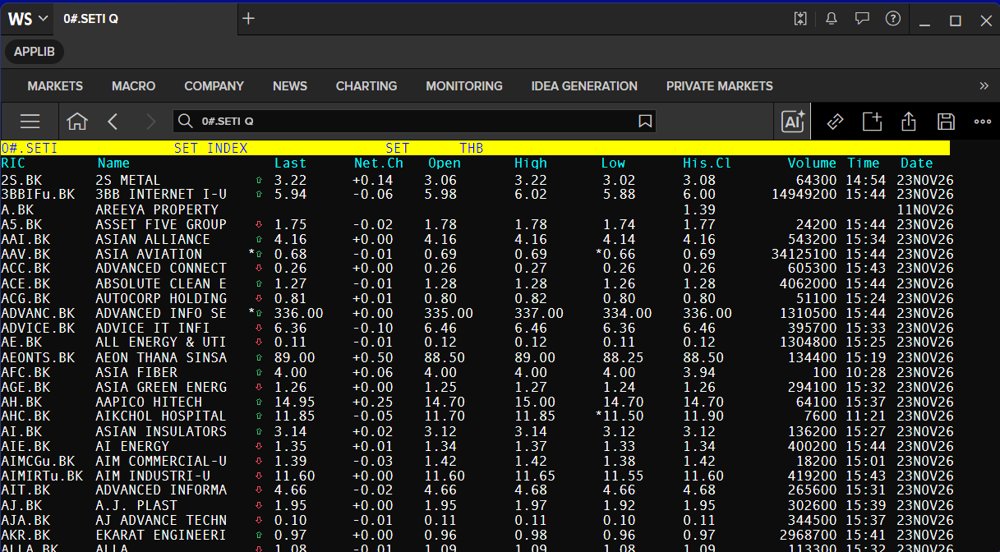
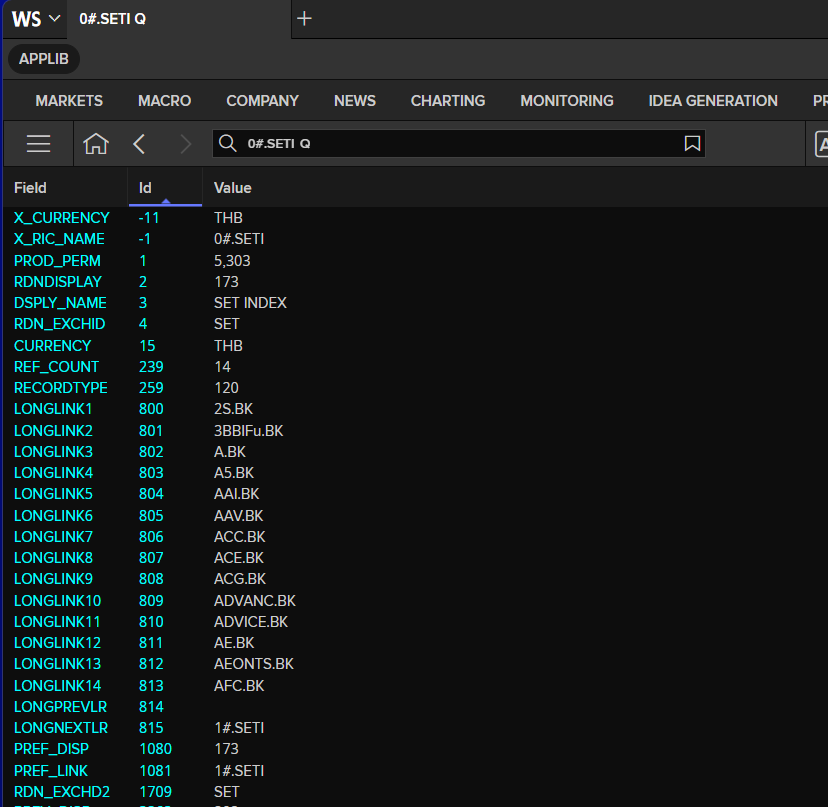

# Getting Historical Chain Constituents with LSEG Tick History REST API and LSEG Data Library for Python

## Overview

The [LSEG Data Library for Python](https://developers.lseg.com/en/api-catalog/lseg-data-platform/lseg-data-library-for-python) `Chain` object returns a chain's constituents, which you can then use with `get_data` and `get_history`. But some bonds chains change its constituent over time because exchanges periodically update which bonds meet the  maturity and coupon criteria for delivery. For instance, newly issued Treasuries are added while older bonds that have fallen below the minimum remaining maturity are removed. 

Examples:
- **0#TYc1=DLV**: CBoT 10-Year US Treasury Note
- **0#FGBMc1=DLV**: Eurex Euro-Bobl (5-year German Govt Bond)
- **0#JGBc1=DLV**: Osaka Exchange 10-Year Japanese Government Bond

The `Chain` object returns **current constituents** because it gets data from the Real-Time platform. To resolve constituents for a specific time, use the [LSEG Tick History REST API](https://developers.lseg.com/en/api-catalog/refinitiv-tick-history/refinitiv-tick-history-rth-rest-api), which supports current and past constituents, including inactive, historical-only instruments. 

Once you get the constituents of that specific time from the Tick History, you can then retrieve their historical data with Tick History, the Data Library, or another LSEG API such as [Data Platform APIs (RDP)](https://developers.lseg.com/en/api-catalog/refinitiv-data-platform/refinitiv-data-platform-apis).

**Note**

You can also use the Tick History REST API for the entire workflow. See the [Tick History REST API tutorials](https://developers.lseg.com/en/api-catalog/refinitiv-tick-history/refinitiv-tick-history-rth-rest-api/tutorials#rest-api-tutorials-introduction) for details. This example is for developers who use the Data Library as their primary API.

## A Brief Introduction to Chain 

Let’s start with an quick introduction to chain RIC. Chain RICs hold instrument names that have a common association. For example, a chain may contain the constituents of a market index like the Dow Jones or the list of strike prices on a particular option contract. It is important to note that chains contain the instrument names (RIC Code) but not the values of the instruments. If you are interested in the instruments’ values, you must explicitly request these instruments. 

For example, in the screenshots below, the Workspace Quote app displays both the names and the values of the Stock Exchange of Thailand (SET - `0#.SETI` RIC) constituents. To this aim, it first subscribed to the chain to get the names of the constituent, then it subscribed to these constituents to get their values.



If you change the display view to "display all fields", you see that the `0#.SETI` RIC contains only its constituent names.

 

As market conditions change, chain RICs can change their constituents over time as new RICs are added and existing RICs are removed. Deliverable-basket chains are one example.

## Deliverable Basket Chains Examples 

Here are examples of bond futures deliverable basket chain RICs, built from the active futures contracts found.

| Market | Deliverable Basket Chain | Futures Root | Futures Continuation RIC | Description |
|---|---|---|---|---|
| US Treasury Futures (CBOT) | `0#TYc1=DLV` | `TY` | `TYc1` | CBoT 10-Year US Treasury Note |
| US Treasury Futures (CBOT) | `0#FVc1=DLV` | `FV` | `FVc1` | CBoT 5-Year US Treasury Note |
| US Treasury Futures (CBOT) | `0#TUc1=DLV` | `TU` | `TUc1` | CBoT 2-Year US Treasury Note |
| US Treasury Futures (CBOT) | `0#AULc1=DLV` | `AUL` | `AULc1` | CBoT Ultra T-Bond (Long-term US Treasury) |
| European Government Bond Futures (Eurex) | `0#FGBLc1=DLV` | `FGBL` | `FGBLc1` | Eurex Euro-Bund (10-year German Govt Bond) |
| European Government Bond Futures (Eurex) | `0#FGBMc1=DLV` | `FGBM` | `FGBMc1` | Eurex Euro-Bobl (5-year German Govt Bond) |
| European Government Bond Futures (Eurex) | `0#FGBSc1=DLV` | `FGBS` | `FGBSc1` | Eurex Euro-Schatz (2-year German Govt Bond) |
| UK Gilt Futures (ICE Europe) | `0#FLGc1=DLV` | `FLG` | `FLGc1` | ICE Europe Long Gilt |
| Japan & Australia | `0#JGBc1=DLV` | `JGB` | `JGBc1` | Osaka Exchange 10-Year Japanese Government Bond |
| Japan & Australia | `0#YTTc1=DLV` | `YTT` | `YTTc1` | ASX 3-Year Australian Treasury Bond |
| Japan & Australia | `0#YTCc1=DLV` | `YTC` | `YTCc1` | ASX 10-Year Australian Treasury Bond |

### How the Pattern Works

- `0#` chain RIC prefix, which is an expanding list of constituents.
- **Future Root** (for example, `TY`, `FV`, or `FGBL`) identifies the futures contract series.
- `c1` is the front-month, or nearest, continuation. Substitute `c2` for the second-month contract, `c3` for the third, and so on.
- `=DLV` is the deliverable basket suffix, listing the bonds currently eligible for physical delivery into that futures contract.

The constituent bonds change over time because exchanges periodically update which bonds meet the maturity and coupon criteria for delivery. For instance, newly issued Treasuries are added while older bonds that have fallen below the minimum remaining maturity are removed.

### Note

Please note that not every exchange may expose its deliverable basket through the `=DLV` chain RIC convention. I strongly suggest you contact the Content Support Team to verify the chain ric name and structure of the exchange and data you need.

That covers the chain RICs constituent changed. 

## Prerequisites

1. DataScope Select credentials and permission to access the Tick History REST API
2. Workspace or Data Platform access for the LSEG Data Library for Python
3. Python 3.12 or later
4. Network access to LSEG services

Contact your LSEG Account Manager or CSM team to request API access.

## Code Walkthrough

Now let me move on to step-by-step code walkthrough.

### Prerequisite  

To use the Tick History REST API, you need DataScope Select (DSS) credentials and permission for the service. Workspace or Data Platform access alone does not grant DSS access; contact your LSEG Account Manager or CSM team to request it.

```python

import os
import time
import requests
BASE_URL = "https://selectapi.datascope.lseg.com/RestApi/v1"
TIMEOUT = 30  # seconds

DSS_USERNAME = os.environ.get("DSS_USERNAME")
DSS_PASSWORD = os.environ.get("DSS_PASSWORD")

if not DSS_USERNAME or not DSS_PASSWORD:
    raise ValueError("Please set DSS_USERNAME and DSS_PASSWORD environment variables.")
```

## Authentication with DSS Server

First, request an authentication token from the DSS server. The request must include valid DSS credentials. For details, see [Tick History - REST API Tutorial 1: Connecting to the server](https://developers.lseg.com/en/api-catalog/refinitiv-tick-history/refinitiv-tick-history-rth-rest-api/tutorials#rest-api-tutorial-1-connecting-to-the-server).

This project uses a [Requests Library Session object](https://requests.readthedocs.io/en/latest/user/advanced/#session-objects) for all HTTP requests to DSS. A session reuses the TCP connection when making multiple requests to the same host, which can significantly improve performance. It also lets you set parameters, such as HTTP headers and cookies, that persist across requests.

```python

# Reuse this session and its headers for Tick History requests.
session = requests.Session()
session.headers["Content-Type"] = "application/json"
session.headers["Prefer"] = "respond-async"


#BASE_URL = "https://selectapi.datascope.lseg.com/RestApi/v1"

# Get an access token using the DSS credentials.
try:
    auth_response = session.post(
        f"{BASE_URL}/Authentication/RequestToken",
        json={"Credentials": {"Username": DSS_USERNAME, "Password": DSS_PASSWORD}},
        timeout=TIMEOUT,
    )
    auth_response.raise_for_status()
    print(f"Authentication Tick History response: {auth_response.status_code}")
    token = auth_response.json()["value"]
    if token:
        print("Token obtained")
except requests.exceptions.RequestException as exc:
    raise RuntimeError("DSS authentication request failed") from exc

# Include the token in later API requests.
if token:
    session.headers["Authorization"] = f"Token {token}"
```

Example output:

```text
Authentication Tick History response: 200
Token obtained
```

The DSS authentication token is valid for 24 hours. Include it in the HTTP `Authorization` header as `Token {DSS Token}` in all Tick History data extraction requests.

That’s all I have to say about the 

### Resolving Historical Chain Constituents

That brings us to the Historical Chain expansion part. The Tick History REST API's `/Search/HistoricalChainResolution` endpoint resolves the constituents of a Chain RIC for a specified date range. It supports currently active, or inactive 'historical only' instruments.

Notice that the `_session.post()` statement call does not include an `Authorization` header. We added the header to the `session` object during authentication, so Requests includes it automatically with every request made through that session. 

I define the historical chain constituent extraction in a `resolve_chain_request` function so we can call the endpoint multiple times throughout the workflow. Pass the `session` object to the function as `_session` each time.

You can find more detail regarding the `/Search/HistoricalChainResolution` endpoint from [Tick History - REST API Tutorial 15: Historical Chain Constituents Search](https://developers.lseg.com/en/api-catalog/refinitiv-tick-history/refinitiv-tick-history-rth-rest-api/tutorials#rest-api-tutorial-15-historical-chain-constituents-search).

```python

def resolve_chain_request(request_session, base_url, chain_rics_list, start, end, timeout):
    """Return a dict of `{chain_ric: constituents}` for `chain_rics_list` between `start` and `end`."""
    print(f"Resolving {chain_rics_list} from {start} to {end}")

    payload = {
        "Request": {
            "ChainRics": chain_rics_list,
            "Range": {"Start": start, "End": end},
        }
    }

    try:
        historical_chain_response = request_session.post(
            f"{base_url}/Search/HistoricalChainResolution",
            json=payload,
            timeout=timeout,
        )

        # HTTP 202 = still processing; poll the monitor URL in the Location header until it returns 200
        while historical_chain_response.status_code == 202:
            print("Request is still processing, waiting 5 seconds...")
            time.sleep(5)
            historical_chain_response = request_session.get(historical_chain_response.headers["Location"], timeout=timeout)

        # Stop here if the API reports an error.
        historical_chain_response.raise_for_status()
        print(f"Historical Chain Resolution response: {historical_chain_response.status_code}")
        # Only a completed 200 response contains the constituent data.
        if historical_chain_response.status_code == 200:
            results = historical_chain_response.json().get("value", [])
            if not results:
                print(f"Historical Chain Resolution: No chain resolution results returned for {chain_rics_list}")
                return {}
            # Build a dict that maps each chain RIC to its list of constituents.
            # Example: {"0#TYc1=DLV": [...], "0#FGBMc1=DLV": [...]}
            constituents_by_chain = {chain["Identifier"]: chain.get("Constituents", []) for chain in results}
            for chain_ric, constituents in constituents_by_chain.items():
                print(f"Historical Chain Resolution: {chain_ric} - {len(constituents)} constituents returned")
            return constituents_by_chain
        return {}
    except requests.exceptions.RequestException as exc:
        raise RuntimeError("Historical chain resolution request failed") from exc
```

#### Requesting 2024 Period

Lets make a first `/Search/HistoricalChainResolution` endpoint call via `resolve_chain_request` method. I am requesting *0#TYc1=DLV* (CBoT 10-Year US Treasury Note) and *#FGBMc1=DLV* (5-year German Govt Bond) RIC on the May and June 2024 period.

```python
CHAIN_RICS = ["0#TYc1=DLV", "0#FGBMc1=DLV"]
START_2024 = "2024-05-01T00:00:00.000Z"
END_2024 = "2024-06-30T00:00:00.000Z"

# Fetch 2024 constituents via resolve_chain_request()
constituents_2024 = resolve_chain_request(
    request_session=session,
    base_url=BASE_URL,
    chain_rics_list=CHAIN_RICS,
    start=START_2024,
    end=END_2024,
    timeout=TIMEOUT
)
```

Output: 

```text
Resolving ['0#TYc1=DLV', '0#FGBMc1=DLV'] from 2024-05-01T00:00:00.000Z to 2024-06-30T00:00:00.000Z
Historical Chain Resolution response: 200
Historical Chain Resolution: 0#TYc1=DLV - 18 constituents returned
Historical Chain Resolution: 0#FGBMc1=DLV - 6 constituents returned
```

The response is a Python dictionary: each chain RIC is a key, and its value is the list of constituent records for that chain (`{"0#TYc1=DLV": [...], "0#FGBMc1=DLV": [...]}`). For example, `constituents_2024["0#TYc1=DLV"]` returns the constituent records for the CBoT 10-Year US Treasury chain.

The `get_valid_rics` function selects the requested chain's records, keeps only those with `"Status": "Valid"` and `"IdentifierType": "Ric"`, and returns their identifiers. The results are stored in `us_10y_treasury_rics_2024` and `euro_bobl_5y_rics_2024`variables.

```python
def get_valid_rics(constituents,chain_ric):
    """Return identifiers marked valid and typed as RIC for the selected chain."""
    return [
        item["Identifier"]
        for item in constituents[chain_ric]
        if item["Status"] == "Valid" and item["IdentifierType"] == "Ric"
    ]

us_10y_treasury_rics_2024 = get_valid_rics(constituents_2024, CHAIN_RICS[0])
euro_bobl_5y_rics_2024 = get_valid_rics(constituents_2024, CHAIN_RICS[1])

```

The list of *0#TYc1=DLV* constituents from May to end of June 2024 is as follows:

**Output (plain text):**

```text
['91282CBL4=',
 '91282CCB5=',
 '91282CCS8=',
 '91282CDJ7=',
 '91282CDY4=',
 '91282CEP2=',
 '91282CFF3=',
 '91282CFV8=',
 '91282CGM7=',
 '91282CHC8=',
 '91282CJQ5=',
 '91282CJX0=',
 '91282CKC4=',
 '91282CKF7=',
 '91282CKN0=',
 '91282CKQ3=',
 '91282CKU4=',
 '91282CKW0=']
```

The list of *0#FGBMc1=DLV* constituents from May to end of June 2024 is as follows:

```text
['DE110246=', 'DE110247=', 'DE110249=', 'DE110262=', 'DEBU2502=', 'DEBU3502=']
```

#### Requesting 2026 Period

Lets try to request the same *0#TYc1=DLV* and *#FGBMc1=DLV* constituent RICs from the May to June 2026 period.

```python
START_2026 = "2026-05-01T00:00:00.000Z"
END_2026   = "2026-06-30T00:00:00.000Z"

# Fetch 2026 constituents via resolve_chain_request()
constituents_2026 = resolve_chain_request(
    request_session = session, 
    base_url = BASE_URL, 
    chain_rics_list = CHAIN_RICS,
    start = START_2026, 
    end = END_2026, 
    timeout = TIMEOUT
)
```

**Output:**

```text
Resolving ['0#TYc1=DLV', '0#FGBMc1=DLV'] from 2026-05-01T00:00:00.000Z to 2026-06-30T00:00:00.000Z
Historical Chain Resolution response: 200
Historical Chain Resolution: 0#TYc1=DLV - 19 constituents returned
Historical Chain Resolution: 0#FGBMc1=DLV - 5 constituents returned
```

```python
us_10y_treasury_rics_2026 = get_valid_rics(constituents_2026, CHAIN_RICS[0])
euro_bobl_5y_rics_2026 = get_valid_rics(constituents_2026, CHAIN_RICS[1])
```

The list of *0#TYc1=DLV* constituents from May to end of June 2026 is as follows:

```text
['91282CDJ7=',
 '91282CDY4=',
 '91282CFF3=',
 '91282CFV8=',
 '91282CGM7=',
 '91282CHC8=',
 '91282CHT1=',
 '91282CJJ1=',
 '91282CJZ5=',
 '91282CKQ3=',
 '91282CLF6=',
 '91282CPQ8=',
 '91282CPY1=',
 '91282CQC8=',
 '91282CQF1=',
 '91282CQN4=',
 '91282CQQ7=',
 '91282CQT1=',
 '91282CQW4=']
```

The list of *0#FGBMc1=DLV* constituents from May to end of June 2026 is as follows:

```text
['DE103073=', 'DE110253=', 'DE110256=', 'DE110258=', 'DEBU2506=']
```


A quick reminder: You can use the LSEG Tick History REST API for the entire workflow, including retrieving historical data for these constituents (`us_10y_treasury_rics_2024`, `euro_bobl_5y_rics_2024`), without using any other LSEG APIs. For example:
- [REST API Tutorial 6: On Demand intraday bars extraction](https://developers.lseg.com/en/api-catalog/refinitiv-tick-history/refinitiv-tick-history-rth-rest-api/tutorials#rest-api-tutorial-6-on-demand-intraday-bars-extraction)
- [REST API Tutorial 4: On Demand tick data extraction](https://developers.lseg.com/en/api-catalog/refinitiv-tick-history/refinitiv-tick-history-rth-rest-api/tutorials#rest-api-tutorial-4-on-demand-tick-data-extraction)

The workflow below uses the LSEG Data Library with a Desktop Session to retrieve historical data for the same RICs and date range from Workspace. You can also use a Platform Session to retrieve data from the Data Platform ([see Data Library for Python QuickStart page](https://developers.lseg.com/en/api-catalog/lseg-data-platform/lseg-data-library-for-python/quick-start)).

```python
import lseg.data as ld
```

```python
ld.open_session()
```

**Output (plain text):**

```text
<lseg.data.session.Definition object at 0x1e9408d2600 {name='workspace'}>
```

I am demonstrating with Data Library `get_history` method to request historical data in a simplest way. You can see the example and full potential of this method from [EX-1.01.02-GetHistory.ipynb](https://github.com/LSEG-API-Samples/Example.DataLibrary.Python/blob/lseg-data-examples/Examples/1-Access/EX-1.01.02-GetHistory.ipynb) example code.

```python
us_10y_treasury_history_2024 = ld.get_history(
    universe=us_10y_treasury_rics_2024[0:6],
    fields=["BID", "ASK"],
    interval="weekly",
    start=START_2024,
    end=END_2024,
)

us_10y_treasury_history_2024.head(20)
```

**Output (HTML):**

<div>
<style scoped>
    .dataframe tbody tr th:only-of-type {
        vertical-align: middle;
    }

    .dataframe tbody tr th {
        vertical-align: top;
    }

    .dataframe thead tr th {
        text-align: left;
    }

    .dataframe thead tr:last-of-type th {
        text-align: right;
    }
</style>
<table border="1" class="dataframe">
  <thead>
    <tr>
      <th></th>
      <th colspan="2" halign="left">91282CBL4=</th>
      <th colspan="2" halign="left">91282CCB5=</th>
      <th colspan="2" halign="left">91282CCS8=</th>
      <th colspan="2" halign="left">91282CDJ7=</th>
      <th colspan="2" halign="left">91282CDY4=</th>
      <th colspan="2" halign="left">91282CEP2=</th>
    </tr>
    <tr>
      <th></th>
      <th>BID</th>
      <th>ASK</th>
      <th>BID</th>
      <th>ASK</th>
      <th>BID</th>
      <th>ASK</th>
      <th>BID</th>
      <th>ASK</th>
      <th>BID</th>
      <th>ASK</th>
      <th>BID</th>
      <th>ASK</th>
    </tr>
    <tr>
      <th>Date</th>
      <th></th>
      <th></th>
      <th></th>
      <th></th>
      <th></th>
      <th></th>
      <th></th>
      <th></th>
      <th></th>
      <th></th>
      <th></th>
      <th></th>
    </tr>
  </thead>
  <tbody>
    <tr>
      <th>2024-05-03</th>
      <td>80.78125</td>
      <td>80.875</td>
      <td>82.984375</td>
      <td>83.0625</td>
      <td>80.15625</td>
      <td>80.210938</td>
      <td>80.273438</td>
      <td>80.320312</td>
      <td>82.9375</td>
      <td>83.0</td>
      <td>89.125</td>
      <td>89.179688</td>
    </tr>
    <tr>
      <th>2024-05-10</th>
      <td>80.742188</td>
      <td>80.8125</td>
      <td>82.929688</td>
      <td>83.0</td>
      <td>80.09375</td>
      <td>80.164062</td>
      <td>80.25</td>
      <td>80.3125</td>
      <td>82.90625</td>
      <td>82.96875</td>
      <td>89.0625</td>
      <td>89.132812</td>
    </tr>
    <tr>
      <th>2024-05-17</th>
      <td>81.164062</td>
      <td>81.25</td>
      <td>83.367188</td>
      <td>83.4375</td>
      <td>80.5625</td>
      <td>80.625</td>
      <td>80.742188</td>
      <td>80.789062</td>
      <td>83.40625</td>
      <td>83.46875</td>
      <td>89.601562</td>
      <td>89.648438</td>
    </tr>
    <tr>
      <th>2024-05-24</th>
      <td>80.84375</td>
      <td>80.914062</td>
      <td>83.054688</td>
      <td>83.117188</td>
      <td>80.25</td>
      <td>80.304688</td>
      <td>80.4375</td>
      <td>80.492188</td>
      <td>83.101562</td>
      <td>83.15625</td>
      <td>89.273438</td>
      <td>89.320312</td>
    </tr>
    <tr>
      <th>2024-05-31</th>
      <td>80.773438</td>
      <td>80.84375</td>
      <td>82.960938</td>
      <td>83.023438</td>
      <td>80.148438</td>
      <td>80.21875</td>
      <td>80.320312</td>
      <td>80.375</td>
      <td>82.960938</td>
      <td>83.015625</td>
      <td>89.09375</td>
      <td>89.148438</td>
    </tr>
    <tr>
      <th>2024-06-07</th>
      <td>81.15625</td>
      <td>81.21875</td>
      <td>83.335938</td>
      <td>83.398438</td>
      <td>80.554688</td>
      <td>80.609375</td>
      <td>80.71875</td>
      <td>80.78125</td>
      <td>83.40625</td>
      <td>83.445312</td>
      <td>89.539062</td>
      <td>89.59375</td>
    </tr>
    <tr>
      <th>2024-06-14</th>
      <td>82.382812</td>
      <td>82.476562</td>
      <td>84.59375</td>
      <td>84.695312</td>
      <td>81.804688</td>
      <td>81.929688</td>
      <td>82.0</td>
      <td>82.125</td>
      <td>84.726562</td>
      <td>84.820312</td>
      <td>90.945312</td>
      <td>91.039062</td>
    </tr>
    <tr>
      <th>2024-06-21</th>
      <td>82.21875</td>
      <td>82.28125</td>
      <td>84.40625</td>
      <td>84.46875</td>
      <td>81.59375</td>
      <td>81.65625</td>
      <td>81.8125</td>
      <td>81.875</td>
      <td>84.539062</td>
      <td>84.59375</td>
      <td>90.75</td>
      <td>90.8125</td>
    </tr>
    <tr>
      <th>2024-06-28</th>
      <td>81.648438</td>
      <td>81.703125</td>
      <td>83.804688</td>
      <td>83.867188</td>
      <td>81.03125</td>
      <td>81.078125</td>
      <td>81.203125</td>
      <td>81.25</td>
      <td>83.8125</td>
      <td>83.875</td>
      <td>89.96875</td>
      <td>90.03125</td>
    </tr>
    <tr>
      <th>2024-07-05</th>
      <td>82.367188</td>
      <td>82.460938</td>
      <td>84.554688</td>
      <td>84.648438</td>
      <td>81.789062</td>
      <td>81.875</td>
      <td>81.992188</td>
      <td>82.046875</td>
      <td>84.648438</td>
      <td>84.710938</td>
      <td>90.8125</td>
      <td>90.875</td>
    </tr>
  </tbody>
</table>
</div>

**Output (plain text):**

```text
           91282CBL4=            91282CCB5=            91282CCS8=             \
                  BID        ASK        BID        ASK        BID        ASK   
Date                                                                           
2024-05-03   80.78125     80.875  82.984375    83.0625   80.15625  80.210938   
2024-05-10  80.742188    80.8125  82.929688       83.0   80.09375  80.164062   
2024-05-17  81.164062      81.25  83.367188    83.4375    80.5625     80.625   
2024-05-24   80.84375  80.914062  83.054688  83.117188      80.25  80.304688   
2024-05-31  80.773438   80.84375  82.960938  83.023438  80.148438   80.21875   
2024-06-07   81.15625   81.21875  83.335938  83.398438  80.554688  80.609375   
2024-06-14  82.382812  82.476562   84.59375  84.695312  81.804688  81.929688   
2024-06-21   82.21875   82.28125   84.40625   84.46875   81.59375   81.65625   
2024-06-28  81.648438  81.703125  83.804688  83.867188   81.03125  81.078125   
2024-07-05  82.367188  82.460938  84.554688  84.648438  81.789062     81.875   

           91282CDJ7=            91282CDY4=            91282CEP2=             
                  BID        ASK        BID        ASK        BID        ASK  
Date                                                                          
2024-05-03  80.273438  80.320312    82.9375       83.0     89.125  89.179688  
2024-05-10      80.25    80.3125   82.90625   82.96875    89.0625  89.132812  
2024-05-17  80.742188  80.789062   83.40625   83.46875  89.601562  89.648438  
2024-05-24    80.4375  80.492188  83.101562   83.15625  89.273438  89.320312  
2024-05-31  80.320312     80.375  82.960938  83.015625   89.09375  89.148438  
2024-06-07   80.71875   80.78125   83.40625  83.445312  89.539062   89.59375  
2024-06-14       82.0     82.125  84.726562  84.820312  90.945312  91.039062  
2024-06-21    81.8125     81.875  84.539062   84.59375      90.75    90.8125  
2024-06-28  81.203125      81.25    83.8125     83.875   89.96875   90.03125  
2024-07-05  81.992188  82.046875  84.648438  84.710938    90.8125     90.875
```

Next, requesting daily historical data of *#FGBMc1=DLV* RIC with daily interval.

```python
euro_bobl_5y_history_2024 = ld.get_history(
    universe=euro_bobl_5y_rics_2024,
    fields=["BID", "ASK"],
    interval="daily",
    start=START_2024,
    end=END_2024,
)

euro_bobl_5y_history_2024.head(20)
```

**Output (HTML):**

<div>
<style scoped>
    .dataframe tbody tr th:only-of-type {
        vertical-align: middle;
    }

    .dataframe tbody tr th {
        vertical-align: top;
    }

    .dataframe thead tr th {
        text-align: left;
    }

    .dataframe thead tr:last-of-type th {
        text-align: right;
    }
</style>
<table border="1" class="dataframe">
  <thead>
    <tr>
      <th></th>
      <th colspan="2" halign="left">DE110246=</th>
      <th colspan="2" halign="left">DE110247=</th>
      <th colspan="2" halign="left">DE110249=</th>
      <th colspan="2" halign="left">DE110262=</th>
      <th colspan="2" halign="left">DEBU2502=</th>
      <th colspan="2" halign="left">DEBU3502=</th>
    </tr>
    <tr>
      <th></th>
      <th>BID</th>
      <th>ASK</th>
      <th>BID</th>
      <th>ASK</th>
      <th>BID</th>
      <th>ASK</th>
      <th>BID</th>
      <th>ASK</th>
      <th>BID</th>
      <th>ASK</th>
      <th>BID</th>
      <th>ASK</th>
    </tr>
    <tr>
      <th>Date</th>
      <th></th>
      <th></th>
      <th></th>
      <th></th>
      <th></th>
      <th></th>
      <th></th>
      <th></th>
      <th></th>
      <th></th>
      <th></th>
      <th></th>
    </tr>
  </thead>
  <tbody>
    <tr>
      <th>2024-05-02</th>
      <td>89.799</td>
      <td>89.813</td>
      <td>87.681</td>
      <td>87.709</td>
      <td>86.681</td>
      <td>86.718</td>
      <td>97.666</td>
      <td>97.703</td>
      <td>97.764</td>
      <td>97.785</td>
      <td>97.779</td>
      <td>97.866</td>
    </tr>
    <tr>
      <th>2024-05-03</th>
      <td>90.032</td>
      <td>90.047</td>
      <td>87.944</td>
      <td>87.973</td>
      <td>86.947</td>
      <td>86.988</td>
      <td>97.946</td>
      <td>97.977</td>
      <td>98.024</td>
      <td>98.044</td>
      <td>98.032</td>
      <td>98.119</td>
    </tr>
    <tr>
      <th>2024-05-06</th>
      <td>90.155</td>
      <td>90.17</td>
      <td>88.087</td>
      <td>88.115</td>
      <td>87.101</td>
      <td>87.139</td>
      <td>98.102</td>
      <td>98.135</td>
      <td>98.158</td>
      <td>98.177</td>
      <td>98.195</td>
      <td>98.22</td>
    </tr>
    <tr>
      <th>2024-05-07</th>
      <td>90.318</td>
      <td>90.332</td>
      <td>88.277</td>
      <td>88.304</td>
      <td>87.318</td>
      <td>87.356</td>
      <td>98.312</td>
      <td>98.345</td>
      <td>98.338</td>
      <td>98.359</td>
      <td>98.376</td>
      <td>98.407</td>
    </tr>
    <tr>
      <th>2024-05-08</th>
      <td>90.169</td>
      <td>90.182</td>
      <td>88.103</td>
      <td>88.13</td>
      <td>87.129</td>
      <td>87.163</td>
      <td>98.117</td>
      <td>98.145</td>
      <td>98.163</td>
      <td>98.18</td>
      <td>98.202</td>
      <td>98.227</td>
    </tr>
    <tr>
      <th>2024-05-09</th>
      <td>90.077</td>
      <td>90.092</td>
      <td>87.992</td>
      <td>88.023</td>
      <td>87.003</td>
      <td>87.037</td>
      <td>97.969</td>
      <td>98.007</td>
      <td>98.042</td>
      <td>98.06</td>
      <td>98.078</td>
      <td>98.11</td>
    </tr>
    <tr>
      <th>2024-05-10</th>
      <td>89.954</td>
      <td>89.966</td>
      <td>87.872</td>
      <td>87.898</td>
      <td>86.872</td>
      <td>86.912</td>
      <td>97.834</td>
      <td>97.864</td>
      <td>97.91</td>
      <td>97.928</td>
      <td>97.946</td>
      <td>97.974</td>
    </tr>
    <tr>
      <th>2024-05-13</th>
      <td>90.031</td>
      <td>90.044</td>
      <td>87.954</td>
      <td>87.983</td>
      <td>86.959</td>
      <td>86.996</td>
      <td>97.924</td>
      <td>97.955</td>
      <td>97.989</td>
      <td>98.007</td>
      <td>98.026</td>
      <td>98.057</td>
    </tr>
    <tr>
      <th>2024-05-14</th>
      <td>89.895</td>
      <td>89.906</td>
      <td>87.801</td>
      <td>87.826</td>
      <td>86.79</td>
      <td>86.827</td>
      <td>97.747</td>
      <td>97.778</td>
      <td>97.829</td>
      <td>97.847</td>
      <td>97.866</td>
      <td>97.9</td>
    </tr>
    <tr>
      <th>2024-05-15</th>
      <td>90.384</td>
      <td>90.399</td>
      <td>88.339</td>
      <td>88.366</td>
      <td>87.374</td>
      <td>87.411</td>
      <td>98.339</td>
      <td>98.37</td>
      <td>98.365</td>
      <td>98.383</td>
      <td>98.391</td>
      <td>98.441</td>
    </tr>
    <tr>
      <th>2024-05-16</th>
      <td>90.266</td>
      <td>90.278</td>
      <td>88.208</td>
      <td>88.237</td>
      <td>87.246</td>
      <td>87.283</td>
      <td>98.181</td>
      <td>98.208</td>
      <td>98.218</td>
      <td>98.236</td>
      <td>98.245</td>
      <td>98.296</td>
    </tr>
    <tr>
      <th>2024-05-17</th>
      <td>89.971</td>
      <td>89.981</td>
      <td>87.886</td>
      <td>87.916</td>
      <td>86.896</td>
      <td>86.933</td>
      <td>97.816</td>
      <td>97.843</td>
      <td>97.883</td>
      <td>97.9</td>
      <td>97.914</td>
      <td>97.959</td>
    </tr>
    <tr>
      <th>2024-05-20</th>
      <td>89.912</td>
      <td>89.927</td>
      <td>87.822</td>
      <td>87.861</td>
      <td>86.831</td>
      <td>86.87</td>
      <td>97.734</td>
      <td>97.771</td>
      <td>97.82</td>
      <td>97.841</td>
      <td>97.852</td>
      <td>97.899</td>
    </tr>
    <tr>
      <th>2024-05-21</th>
      <td>90.023</td>
      <td>90.038</td>
      <td>87.943</td>
      <td>87.971</td>
      <td>86.956</td>
      <td>86.992</td>
      <td>97.866</td>
      <td>97.895</td>
      <td>97.932</td>
      <td>97.951</td>
      <td>97.964</td>
      <td>98.014</td>
    </tr>
    <tr>
      <th>2024-05-22</th>
      <td>89.915</td>
      <td>89.927</td>
      <td>87.817</td>
      <td>87.845</td>
      <td>86.82</td>
      <td>86.853</td>
      <td>97.73</td>
      <td>97.758</td>
      <td>97.801</td>
      <td>97.82</td>
      <td>97.83</td>
      <td>97.877</td>
    </tr>
    <tr>
      <th>2024-05-23</th>
      <td>89.583</td>
      <td>89.594</td>
      <td>87.471</td>
      <td>87.496</td>
      <td>86.454</td>
      <td>86.483</td>
      <td>97.337</td>
      <td>97.362</td>
      <td>97.44</td>
      <td>97.456</td>
      <td>97.47</td>
      <td>97.504</td>
    </tr>
    <tr>
      <th>2024-05-24</th>
      <td>89.656</td>
      <td>89.669</td>
      <td>87.543</td>
      <td>87.572</td>
      <td>86.529</td>
      <td>86.569</td>
      <td>97.401</td>
      <td>97.43</td>
      <td>97.503</td>
      <td>97.522</td>
      <td>97.532</td>
      <td>97.583</td>
    </tr>
    <tr>
      <th>2024-05-27</th>
      <td>89.822</td>
      <td>89.838</td>
      <td>87.723</td>
      <td>87.753</td>
      <td>86.723</td>
      <td>86.761</td>
      <td>97.595</td>
      <td>97.623</td>
      <td>97.677</td>
      <td>97.696</td>
      <td>97.704</td>
      <td>97.751</td>
    </tr>
    <tr>
      <th>2024-05-28</th>
      <td>89.708</td>
      <td>89.721</td>
      <td>87.598</td>
      <td>87.62</td>
      <td>86.577</td>
      <td>86.612</td>
      <td>97.439</td>
      <td>97.468</td>
      <td>97.547</td>
      <td>97.565</td>
      <td>97.569</td>
      <td>97.592</td>
    </tr>
    <tr>
      <th>2024-05-29</th>
      <td>89.415</td>
      <td>89.427</td>
      <td>87.264</td>
      <td>87.29</td>
      <td>86.199</td>
      <td>86.231</td>
      <td>97.061</td>
      <td>97.09</td>
      <td>97.219</td>
      <td>97.238</td>
      <td>97.221</td>
      <td>97.274</td>
    </tr>
  </tbody>
</table>
</div>

**Output (plain text):**

```text
           DE110246=         DE110247=         DE110249=         DE110262=  \
                 BID     ASK       BID     ASK       BID     ASK       BID   
Date                                                                         
2024-05-02    89.799  89.813    87.681  87.709    86.681  86.718    97.666   
2024-05-03    90.032  90.047    87.944  87.973    86.947  86.988    97.946   
2024-05-06    90.155   90.17    88.087  88.115    87.101  87.139    98.102   
2024-05-07    90.318  90.332    88.277  88.304    87.318  87.356    98.312   
2024-05-08    90.169  90.182    88.103   88.13    87.129  87.163    98.117   
2024-05-09    90.077  90.092    87.992  88.023    87.003  87.037    97.969   
2024-05-10    89.954  89.966    87.872  87.898    86.872  86.912    97.834   
2024-05-13    90.031  90.044    87.954  87.983    86.959  86.996    97.924   
2024-05-14    89.895  89.906    87.801  87.826     86.79  86.827    97.747   
2024-05-15    90.384  90.399    88.339  88.366    87.374  87.411    98.339   
2024-05-16    90.266  90.278    88.208  88.237    87.246  87.283    98.181   
2024-05-17    89.971  89.981    87.886  87.916    86.896  86.933    97.816   
2024-05-20    89.912  89.927    87.822  87.861    86.831   86.87    97.734   
2024-05-21    90.023  90.038    87.943  87.971    86.956  86.992    97.866   
2024-05-22    89.915  89.927    87.817  87.845     86.82  86.853     97.73   
2024-05-23    89.583  89.594    87.471  87.496    86.454  86.483    97.337   
2024-05-24    89.656  89.669    87.543  87.572    86.529  86.569    97.401   
2024-05-27    89.822  89.838    87.723  87.753    86.723  86.761    97.595   
2024-05-28    89.708  89.721    87.598   87.62    86.577  86.612    97.439   
2024-05-29    89.415  89.427    87.264   87.29    86.199  86.231    97.061   

                   DEBU2502=         DEBU3502=          
               ASK       BID     ASK       BID     ASK  
Date                                                    
2024-05-02  97.703    97.764  97.785    97.779  97.866  
2024-05-03  97.977    98.024  98.044    98.032  98.119  
2024-05-06  98.135    98.158  98.177    98.195   98.22  
2024-05-07  98.345    98.338  98.359    98.376  98.407  
2024-05-08  98.145    98.163   98.18    98.202  98.227  
2024-05-09  98.007    98.042   98.06    98.078   98.11  
2024-05-10  97.864     97.91  97.928    97.946  97.974  
2024-05-13  97.955    97.989  98.007    98.026  98.057  
2024-05-14  97.778    97.829  97.847    97.866    97.9  
2024-05-15   98.37    98.365  98.383    98.391  98.441  
2024-05-16  98.208    98.218  98.236    98.245  98.296  
2024-05-17  97.843    97.883    97.9    97.914  97.959  
2024-05-20  97.771     97.82  97.841    97.852  97.899  
2024-05-21  97.895    97.932  97.951    97.964  98.014  
2024-05-22  97.758    97.801   97.82     97.83  97.877  
2024-05-23  97.362     97.44  97.456     97.47  97.504  
2024-05-24   97.43    97.503  97.522    97.532  97.583  
2024-05-27  97.623    97.677  97.696    97.704  97.751  
2024-05-28  97.468    97.547  97.565    97.569  97.592  
2024-05-29   97.09    97.219  97.238    97.221  97.274
```


**Output:**

```text
Resolving ['0#TYc1=DLV', '0#FGBMc1=DLV'] from 2026-05-01T00:00:00.000Z to 2026-06-30T00:00:00.000Z
Historical Chain Resolution response: 200
Historical Chain Resolution: 0#TYc1=DLV - 19 constituents returned
Historical Chain Resolution: 0#FGBMc1=DLV - 5 constituents returned
```

```python
us_10y_treasury_rics_2026 = get_valid_rics(constituents_2026, CHAIN_RICS[0])
us_10y_treasury_rics_2026
```

**Output (plain text):**

```text
['91282CDJ7=',
 '91282CDY4=',
 '91282CFF3=',
 '91282CFV8=',
 '91282CGM7=',
 '91282CHC8=',
 '91282CHT1=',
 '91282CJJ1=',
 '91282CJZ5=',
 '91282CKQ3=',
 '91282CLF6=',
 '91282CPQ8=',
 '91282CPY1=',
 '91282CQC8=',
 '91282CQF1=',
 '91282CQN4=',
 '91282CQQ7=',
 '91282CQT1=',
 '91282CQW4=']
```

```python
euro_bobl_5y_rics_2026 = get_valid_rics(constituents_2026, CHAIN_RICS[1])
euro_bobl_5y_rics_2026
```

**Output (plain text):**

```text
['DE103073=', 'DE110253=', 'DE110256=', 'DE110258=', 'DEBU2506=']
```

### Comparing 2024 and 2026 Chain Constituents

Now let's compare the 2024 and 2026 constituent lists in a `pandas` DataFrame, with one row per bond RIC showing whether it was present in `2024`, `2026`, and its `Status` (`Removed`, `Unchanged`, or `Added`). Because deliverable bond baskets update over time—older bonds drop out once they fall below the minimum remaining maturity requirement while newly issued bonds are added—the constituent lists for May–June 2024 and May–June 2026 are different.

```python
import pandas as pd


def compare_chain_constituents(rics_2024, rics_2026):
    """Compare 2024 and 2026 chain constituents in a one-row-per-RIC DataFrame."""
    # Use sets to find which RICs were removed, kept, or newly added.
    set_2024, set_2026 = set(rics_2024), set(rics_2026)
    removed = sorted(set_2024 - set_2026)
    unchanged = sorted(set_2024 & set_2026)
    added = sorted(set_2026 - set_2024)

    print(
        f"2024: {len(set_2024)} | 2026: {len(set_2026)} | "
        f"Removed: {len(removed)}, Unchanged: {len(unchanged)}, Added: {len(added)}"
    )

    # Group RICs by status (Removed -> Unchanged -> Added) with checkmarks for each period.
    groups = [
        (removed, "✓", "—", "Removed"),
        (unchanged, "✓", "✓", "Unchanged"),
        (added, "—", "✓", "Added"),
    ]
    rows = [
        {"RIC": ric, "2024": in_2024, "2026": in_2026, "Status": status}
        for rics, in_2024, in_2026, status in groups
        for ric in rics
    ]

    # Use RIC as the row label instead of 0, 1, 2... row numbers.
    return pd.DataFrame(rows, columns=["RIC", "2024", "2026", "Status"]).set_index("RIC")


compare_chain_constituents(us_10y_treasury_rics_2024, us_10y_treasury_rics_2026)
```

**Output:**

```text
2024: 18 | 2026: 19 | Removed: 11, Unchanged: 7, Added: 12
```

**Output (HTML):**

<div>
<style scoped>
    .dataframe tbody tr th:only-of-type {
        vertical-align: middle;
    }

    .dataframe tbody tr th {
        vertical-align: top;
    }

    .dataframe thead th {
        text-align: right;
    }
</style>
<table border="1" class="dataframe">
  <thead>
    <tr style="text-align: right;">
      <th></th>
      <th>2024</th>
      <th>2026</th>
      <th>Status</th>
    </tr>
    <tr>
      <th>RIC</th>
      <th></th>
      <th></th>
      <th></th>
    </tr>
  </thead>
  <tbody>
    <tr>
      <th>91282CBL4=</th>
      <td>✓</td>
      <td>—</td>
      <td>Removed</td>
    </tr>
    <tr>
      <th>91282CCB5=</th>
      <td>✓</td>
      <td>—</td>
      <td>Removed</td>
    </tr>
    <tr>
      <th>91282CCS8=</th>
      <td>✓</td>
      <td>—</td>
      <td>Removed</td>
    </tr>
    <tr>
      <th>91282CEP2=</th>
      <td>✓</td>
      <td>—</td>
      <td>Removed</td>
    </tr>
    <tr>
      <th>91282CJQ5=</th>
      <td>✓</td>
      <td>—</td>
      <td>Removed</td>
    </tr>
    <tr>
      <th>91282CJX0=</th>
      <td>✓</td>
      <td>—</td>
      <td>Removed</td>
    </tr>
    <tr>
      <th>91282CKC4=</th>
      <td>✓</td>
      <td>—</td>
      <td>Removed</td>
    </tr>
    <tr>
      <th>91282CKF7=</th>
      <td>✓</td>
      <td>—</td>
      <td>Removed</td>
    </tr>
    <tr>
      <th>91282CKN0=</th>
      <td>✓</td>
      <td>—</td>
      <td>Removed</td>
    </tr>
    <tr>
      <th>91282CKU4=</th>
      <td>✓</td>
      <td>—</td>
      <td>Removed</td>
    </tr>
    <tr>
      <th>91282CKW0=</th>
      <td>✓</td>
      <td>—</td>
      <td>Removed</td>
    </tr>
    <tr>
      <th>91282CDJ7=</th>
      <td>✓</td>
      <td>✓</td>
      <td>Unchanged</td>
    </tr>
    <tr>
      <th>91282CDY4=</th>
      <td>✓</td>
      <td>✓</td>
      <td>Unchanged</td>
    </tr>
    <tr>
      <th>91282CFF3=</th>
      <td>✓</td>
      <td>✓</td>
      <td>Unchanged</td>
    </tr>
    <tr>
      <th>91282CFV8=</th>
      <td>✓</td>
      <td>✓</td>
      <td>Unchanged</td>
    </tr>
    <tr>
      <th>91282CGM7=</th>
      <td>✓</td>
      <td>✓</td>
      <td>Unchanged</td>
    </tr>
    <tr>
      <th>91282CHC8=</th>
      <td>✓</td>
      <td>✓</td>
      <td>Unchanged</td>
    </tr>
    <tr>
      <th>91282CKQ3=</th>
      <td>✓</td>
      <td>✓</td>
      <td>Unchanged</td>
    </tr>
    <tr>
      <th>91282CHT1=</th>
      <td>—</td>
      <td>✓</td>
      <td>Added</td>
    </tr>
    <tr>
      <th>91282CJJ1=</th>
      <td>—</td>
      <td>✓</td>
      <td>Added</td>
    </tr>
    <tr>
      <th>91282CJZ5=</th>
      <td>—</td>
      <td>✓</td>
      <td>Added</td>
    </tr>
    <tr>
      <th>91282CLF6=</th>
      <td>—</td>
      <td>✓</td>
      <td>Added</td>
    </tr>
    <tr>
      <th>91282CPQ8=</th>
      <td>—</td>
      <td>✓</td>
      <td>Added</td>
    </tr>
    <tr>
      <th>91282CPY1=</th>
      <td>—</td>
      <td>✓</td>
      <td>Added</td>
    </tr>
    <tr>
      <th>91282CQC8=</th>
      <td>—</td>
      <td>✓</td>
      <td>Added</td>
    </tr>
    <tr>
      <th>91282CQF1=</th>
      <td>—</td>
      <td>✓</td>
      <td>Added</td>
    </tr>
    <tr>
      <th>91282CQN4=</th>
      <td>—</td>
      <td>✓</td>
      <td>Added</td>
    </tr>
    <tr>
      <th>91282CQQ7=</th>
      <td>—</td>
      <td>✓</td>
      <td>Added</td>
    </tr>
    <tr>
      <th>91282CQT1=</th>
      <td>—</td>
      <td>✓</td>
      <td>Added</td>
    </tr>
    <tr>
      <th>91282CQW4=</th>
      <td>—</td>
      <td>✓</td>
      <td>Added</td>
    </tr>
  </tbody>
</table>
</div>

**Output (plain text):**

```text
           2024 2026     Status
RIC                            
91282CBL4=    ✓    —    Removed
91282CCB5=    ✓    —    Removed
91282CCS8=    ✓    —    Removed
91282CEP2=    ✓    —    Removed
91282CJQ5=    ✓    —    Removed
91282CJX0=    ✓    —    Removed
91282CKC4=    ✓    —    Removed
91282CKF7=    ✓    —    Removed
91282CKN0=    ✓    —    Removed
91282CKU4=    ✓    —    Removed
91282CKW0=    ✓    —    Removed
91282CDJ7=    ✓    ✓  Unchanged
91282CDY4=    ✓    ✓  Unchanged
91282CFF3=    ✓    ✓  Unchanged
91282CFV8=    ✓    ✓  Unchanged
91282CGM7=    ✓    ✓  Unchanged
91282CHC8=    ✓    ✓  Unchanged
91282CKQ3=    ✓    ✓  Unchanged
91282CHT1=    —    ✓      Added
91282CJJ1=    —    ✓      Added
91282CJZ5=    —    ✓      Added
91282CLF6=    —    ✓      Added
91282CPQ8=    —    ✓      Added
91282CPY1=    —    ✓      Added
91282CQC8=    —    ✓      Added
91282CQF1=    —    ✓      Added
91282CQN4=    —    ✓      Added
91282CQQ7=    —    ✓      Added
91282CQT1=    —    ✓      Added
91282CQW4=    —    ✓      Added
```

```python
compare_chain_constituents(euro_bobl_5y_rics_2024, euro_bobl_5y_rics_2026)
```

**Output:**

```text
2024: 6 | 2026: 5 | Removed: 6, Unchanged: 0, Added: 5
```

**Output (HTML):**

<div>
<style scoped>
    .dataframe tbody tr th:only-of-type {
        vertical-align: middle;
    }

    .dataframe tbody tr th {
        vertical-align: top;
    }

    .dataframe thead th {
        text-align: right;
    }
</style>
<table border="1" class="dataframe">
  <thead>
    <tr style="text-align: right;">
      <th></th>
      <th>2024</th>
      <th>2026</th>
      <th>Status</th>
    </tr>
    <tr>
      <th>RIC</th>
      <th></th>
      <th></th>
      <th></th>
    </tr>
  </thead>
  <tbody>
    <tr>
      <th>DE110246=</th>
      <td>✓</td>
      <td>—</td>
      <td>Removed</td>
    </tr>
    <tr>
      <th>DE110247=</th>
      <td>✓</td>
      <td>—</td>
      <td>Removed</td>
    </tr>
    <tr>
      <th>DE110249=</th>
      <td>✓</td>
      <td>—</td>
      <td>Removed</td>
    </tr>
    <tr>
      <th>DE110262=</th>
      <td>✓</td>
      <td>—</td>
      <td>Removed</td>
    </tr>
    <tr>
      <th>DEBU2502=</th>
      <td>✓</td>
      <td>—</td>
      <td>Removed</td>
    </tr>
    <tr>
      <th>DEBU3502=</th>
      <td>✓</td>
      <td>—</td>
      <td>Removed</td>
    </tr>
    <tr>
      <th>DE103073=</th>
      <td>—</td>
      <td>✓</td>
      <td>Added</td>
    </tr>
    <tr>
      <th>DE110253=</th>
      <td>—</td>
      <td>✓</td>
      <td>Added</td>
    </tr>
    <tr>
      <th>DE110256=</th>
      <td>—</td>
      <td>✓</td>
      <td>Added</td>
    </tr>
    <tr>
      <th>DE110258=</th>
      <td>—</td>
      <td>✓</td>
      <td>Added</td>
    </tr>
    <tr>
      <th>DEBU2506=</th>
      <td>—</td>
      <td>✓</td>
      <td>Added</td>
    </tr>
  </tbody>
</table>
</div>

**Output (plain text):**

```text
          2024 2026   Status
RIC                         
DE110246=    ✓    —  Removed
DE110247=    ✓    —  Removed
DE110249=    ✓    —  Removed
DE110262=    ✓    —  Removed
DEBU2502=    ✓    —  Removed
DEBU3502=    ✓    —  Removed
DE103073=    —    ✓    Added
DE110253=    —    ✓    Added
DE110256=    —    ✓    Added
DE110258=    —    ✓    Added
DEBU2506=    —    ✓    Added
```

Now I am using the Data Library `get_history` method to request historical data for *0#TYc1=DLV* RIC 2026's constituents using the same query as 2024.

```python
us_10y_treasury_history_2026 = ld.get_history(
    universe=us_10y_treasury_rics_2026[0:6],
    fields=["BID", "ASK"],
    interval="weekly",
    start=START_2026,
    end=END_2026,
)

us_10y_treasury_history_2026.head(20)
```

**Output (HTML):**

<div>
<style scoped>
    .dataframe tbody tr th:only-of-type {
        vertical-align: middle;
    }

    .dataframe tbody tr th {
        vertical-align: top;
    }

    .dataframe thead tr th {
        text-align: left;
    }

    .dataframe thead tr:last-of-type th {
        text-align: right;
    }
</style>
<table border="1" class="dataframe">
  <thead>
    <tr>
      <th></th>
      <th colspan="2" halign="left">91282CDJ7=</th>
      <th colspan="2" halign="left">91282CDY4=</th>
      <th colspan="2" halign="left">91282CFF3=</th>
      <th colspan="2" halign="left">91282CFV8=</th>
      <th colspan="2" halign="left">91282CGM7=</th>
      <th colspan="2" halign="left">91282CHC8=</th>
    </tr>
    <tr>
      <th></th>
      <th>BID</th>
      <th>ASK</th>
      <th>BID</th>
      <th>ASK</th>
      <th>BID</th>
      <th>ASK</th>
      <th>BID</th>
      <th>ASK</th>
      <th>BID</th>
      <th>ASK</th>
      <th>BID</th>
      <th>ASK</th>
    </tr>
    <tr>
      <th>Date</th>
      <th></th>
      <th></th>
      <th></th>
      <th></th>
      <th></th>
      <th></th>
      <th></th>
      <th></th>
      <th></th>
      <th></th>
      <th></th>
      <th></th>
    </tr>
  </thead>
  <tbody>
    <tr>
      <th>2026-05-08</th>
      <td>86.757812</td>
      <td>86.8125</td>
      <td>88.65625</td>
      <td>88.71875</td>
      <td>92.375</td>
      <td>92.4375</td>
      <td>99.820312</td>
      <td>99.875</td>
      <td>96.070312</td>
      <td>96.125</td>
      <td>95.09375</td>
      <td>95.132812</td>
    </tr>
    <tr>
      <th>2026-05-15</th>
      <td>85.6875</td>
      <td>85.726562</td>
      <td>87.523438</td>
      <td>87.570312</td>
      <td>91.125</td>
      <td>91.171875</td>
      <td>98.46875</td>
      <td>98.5</td>
      <td>94.6875</td>
      <td>94.734375</td>
      <td>93.671875</td>
      <td>93.710938</td>
    </tr>
    <tr>
      <th>2026-05-22</th>
      <td>85.796875</td>
      <td>85.859375</td>
      <td>87.648438</td>
      <td>87.71875</td>
      <td>91.273438</td>
      <td>91.335938</td>
      <td>98.625</td>
      <td>98.6875</td>
      <td>94.867188</td>
      <td>94.90625</td>
      <td>93.835938</td>
      <td>93.890625</td>
    </tr>
    <tr>
      <th>2026-05-29</th>
      <td>86.375</td>
      <td>86.429688</td>
      <td>88.25</td>
      <td>88.289062</td>
      <td>91.914062</td>
      <td>91.960938</td>
      <td>99.289062</td>
      <td>99.34375</td>
      <td>95.53125</td>
      <td>95.570312</td>
      <td>94.554688</td>
      <td>94.585938</td>
    </tr>
    <tr>
      <th>2026-06-05</th>
      <td>85.867188</td>
      <td>85.90625</td>
      <td>87.695312</td>
      <td>87.757812</td>
      <td>91.3125</td>
      <td>91.375</td>
      <td>98.625</td>
      <td>98.6875</td>
      <td>94.875</td>
      <td>94.929688</td>
      <td>93.898438</td>
      <td>93.9375</td>
    </tr>
    <tr>
      <th>2026-06-12</th>
      <td>86.164062</td>
      <td>86.21875</td>
      <td>88.03125</td>
      <td>88.070312</td>
      <td>91.664062</td>
      <td>91.710938</td>
      <td>98.96875</td>
      <td>99.007812</td>
      <td>95.21875</td>
      <td>95.257812</td>
      <td>94.25</td>
      <td>94.28125</td>
    </tr>
    <tr>
      <th>2026-06-19</th>
      <td>86.15625</td>
      <td>86.210938</td>
      <td>88.007812</td>
      <td>88.054688</td>
      <td>91.65625</td>
      <td>91.710938</td>
      <td>98.953125</td>
      <td>99.0</td>
      <td>95.242188</td>
      <td>95.28125</td>
      <td>94.257812</td>
      <td>94.3125</td>
    </tr>
    <tr>
      <th>2026-06-26</th>
      <td>86.632812</td>
      <td>86.71875</td>
      <td>88.492188</td>
      <td>88.570312</td>
      <td>92.179688</td>
      <td>92.242188</td>
      <td>99.476562</td>
      <td>99.554688</td>
      <td>95.78125</td>
      <td>95.851562</td>
      <td>94.835938</td>
      <td>94.890625</td>
    </tr>
    <tr>
      <th>2026-07-03</th>
      <td>86.25</td>
      <td>86.3125</td>
      <td>88.09375</td>
      <td>88.140625</td>
      <td>91.679688</td>
      <td>91.726562</td>
      <td>98.914062</td>
      <td>98.96875</td>
      <td>95.210938</td>
      <td>95.257812</td>
      <td>94.25</td>
      <td>94.28125</td>
    </tr>
  </tbody>
</table>
</div>

**Output (plain text):**

```text
           91282CDJ7=            91282CDY4=            91282CFF3=             \
                  BID        ASK        BID        ASK        BID        ASK   
Date                                                                           
2026-05-08  86.757812    86.8125   88.65625   88.71875     92.375    92.4375   
2026-05-15    85.6875  85.726562  87.523438  87.570312     91.125  91.171875   
2026-05-22  85.796875  85.859375  87.648438   87.71875  91.273438  91.335938   
2026-05-29     86.375  86.429688      88.25  88.289062  91.914062  91.960938   
2026-06-05  85.867188   85.90625  87.695312  87.757812    91.3125     91.375   
2026-06-12  86.164062   86.21875   88.03125  88.070312  91.664062  91.710938   
2026-06-19   86.15625  86.210938  88.007812  88.054688   91.65625  91.710938   
2026-06-26  86.632812   86.71875  88.492188  88.570312  92.179688  92.242188   
2026-07-03      86.25    86.3125   88.09375  88.140625  91.679688  91.726562   

           91282CFV8=            91282CGM7=            91282CHC8=             
                  BID        ASK        BID        ASK        BID        ASK  
Date                                                                          
2026-05-08  99.820312     99.875  96.070312     96.125   95.09375  95.132812  
2026-05-15   98.46875       98.5    94.6875  94.734375  93.671875  93.710938  
2026-05-22     98.625    98.6875  94.867188   94.90625  93.835938  93.890625  
2026-05-29  99.289062   99.34375   95.53125  95.570312  94.554688  94.585938  
2026-06-05     98.625    98.6875     94.875  94.929688  93.898438    93.9375  
2026-06-12   98.96875  99.007812   95.21875  95.257812      94.25   94.28125  
2026-06-19  98.953125       99.0  95.242188   95.28125  94.257812    94.3125  
2026-06-26  99.476562  99.554688   95.78125  95.851562  94.835938  94.890625  
2026-07-03  98.914062   98.96875  95.210938  95.257812      94.25   94.28125
```

And for the German 5 years government bond in 2026 with daily interval, we have:

```python
euro_bobl_5y_history_2026 = ld.get_history(
    universe=euro_bobl_5y_rics_2026,
    fields=["BID", "ASK"],
    interval="daily",
    start=START_2026,
    end=END_2026,
)

euro_bobl_5y_history_2026.head(20)
```

**Output (HTML):**

<div>
<style scoped>
    .dataframe tbody tr th:only-of-type {
        vertical-align: middle;
    }

    .dataframe tbody tr th {
        vertical-align: top;
    }

    .dataframe thead tr th {
        text-align: left;
    }

    .dataframe thead tr:last-of-type th {
        text-align: right;
    }
</style>
<table border="1" class="dataframe">
  <thead>
    <tr>
      <th></th>
      <th colspan="2" halign="left">DE103073=</th>
      <th colspan="2" halign="left">DE110253=</th>
      <th colspan="2" halign="left">DE110256=</th>
      <th colspan="2" halign="left">DE110258=</th>
      <th colspan="2" halign="left">DEBU2506=</th>
    </tr>
    <tr>
      <th></th>
      <th>BID</th>
      <th>ASK</th>
      <th>BID</th>
      <th>ASK</th>
      <th>BID</th>
      <th>ASK</th>
      <th>BID</th>
      <th>ASK</th>
      <th>BID</th>
      <th>ASK</th>
    </tr>
    <tr>
      <th>Date</th>
      <th></th>
      <th></th>
      <th></th>
      <th></th>
      <th></th>
      <th></th>
      <th></th>
      <th></th>
      <th></th>
      <th></th>
    </tr>
  </thead>
  <tbody>
    <tr>
      <th>2026-05-04</th>
      <td>86.479</td>
      <td>86.504</td>
      <td>87.775</td>
      <td>87.802</td>
      <td>86.444</td>
      <td>86.473</td>
      <td>85.1</td>
      <td>85.129</td>
      <td>98.604</td>
      <td>98.619</td>
    </tr>
    <tr>
      <th>2026-05-05</th>
      <td>86.607</td>
      <td>86.635</td>
      <td>87.914</td>
      <td>87.939</td>
      <td>86.588</td>
      <td>86.609</td>
      <td>85.251</td>
      <td>85.28</td>
      <td>98.744</td>
      <td>98.752</td>
    </tr>
    <tr>
      <th>2026-05-06</th>
      <td>86.965</td>
      <td>87.035</td>
      <td>88.26</td>
      <td>88.307</td>
      <td>86.967</td>
      <td>86.996</td>
      <td>85.653</td>
      <td>85.683</td>
      <td>99.13</td>
      <td>99.146</td>
    </tr>
    <tr>
      <th>2026-05-07</th>
      <td>86.982</td>
      <td>87.016</td>
      <td>88.266</td>
      <td>88.296</td>
      <td>86.96</td>
      <td>86.984</td>
      <td>85.643</td>
      <td>85.672</td>
      <td>99.11</td>
      <td>99.127</td>
    </tr>
    <tr>
      <th>2026-05-08</th>
      <td>86.929</td>
      <td>86.953</td>
      <td>88.208</td>
      <td>88.251</td>
      <td>86.903</td>
      <td>86.933</td>
      <td>85.573</td>
      <td>85.619</td>
      <td>99.048</td>
      <td>99.063</td>
    </tr>
    <tr>
      <th>2026-05-11</th>
      <td>86.744</td>
      <td>86.779</td>
      <td>88.042</td>
      <td>88.072</td>
      <td>86.722</td>
      <td>86.746</td>
      <td>85.385</td>
      <td>85.431</td>
      <td>98.852</td>
      <td>98.872</td>
    </tr>
    <tr>
      <th>2026-05-12</th>
      <td>86.488</td>
      <td>86.518</td>
      <td>87.802</td>
      <td>87.835</td>
      <td>86.474</td>
      <td>86.491</td>
      <td>85.121</td>
      <td>85.151</td>
      <td>98.589</td>
      <td>98.601</td>
    </tr>
    <tr>
      <th>2026-05-13</th>
      <td>86.396</td>
      <td>86.421</td>
      <td>87.739</td>
      <td>87.766</td>
      <td>86.377</td>
      <td>86.397</td>
      <td>85.04</td>
      <td>85.07</td>
      <td>98.493</td>
      <td>98.51</td>
    </tr>
    <tr>
      <th>2026-05-14</th>
      <td>86.695</td>
      <td>86.718</td>
      <td>88.013</td>
      <td>88.04</td>
      <td>86.682</td>
      <td>86.696</td>
      <td>85.363</td>
      <td>85.387</td>
      <td>98.791</td>
      <td>98.804</td>
    </tr>
    <tr>
      <th>2026-05-15</th>
      <td>86.276</td>
      <td>86.3</td>
      <td>87.64</td>
      <td>87.665</td>
      <td>86.265</td>
      <td>86.288</td>
      <td>84.905</td>
      <td>84.934</td>
      <td>98.37</td>
      <td>98.382</td>
    </tr>
    <tr>
      <th>2026-05-18</th>
      <td>86.291</td>
      <td>86.315</td>
      <td>87.651</td>
      <td>87.676</td>
      <td>86.269</td>
      <td>86.294</td>
      <td>84.909</td>
      <td>84.939</td>
      <td>98.359</td>
      <td>98.373</td>
    </tr>
    <tr>
      <th>2026-05-19</th>
      <td>86.17</td>
      <td>86.194</td>
      <td>87.537</td>
      <td>87.57</td>
      <td>86.15</td>
      <td>86.177</td>
      <td>84.777</td>
      <td>84.806</td>
      <td>98.24</td>
      <td>98.249</td>
    </tr>
    <tr>
      <th>2026-05-20</th>
      <td>86.605</td>
      <td>86.63</td>
      <td>87.936</td>
      <td>87.969</td>
      <td>86.589</td>
      <td>86.609</td>
      <td>85.235</td>
      <td>85.265</td>
      <td>98.675</td>
      <td>98.684</td>
    </tr>
    <tr>
      <th>2026-05-21</th>
      <td>86.554</td>
      <td>86.581</td>
      <td>87.888</td>
      <td>87.914</td>
      <td>86.529</td>
      <td>86.552</td>
      <td>85.165</td>
      <td>85.195</td>
      <td>98.602</td>
      <td>98.616</td>
    </tr>
    <tr>
      <th>2026-05-22</th>
      <td>86.834</td>
      <td>86.86</td>
      <td>88.137</td>
      <td>88.167</td>
      <td>86.815</td>
      <td>86.838</td>
      <td>85.484</td>
      <td>85.504</td>
      <td>98.883</td>
      <td>98.897</td>
    </tr>
    <tr>
      <th>2026-05-25</th>
      <td>87.251</td>
      <td>87.285</td>
      <td>88.516</td>
      <td>88.549</td>
      <td>87.216</td>
      <td>87.262</td>
      <td>85.909</td>
      <td>85.929</td>
      <td>99.289</td>
      <td>99.303</td>
    </tr>
    <tr>
      <th>2026-05-26</th>
      <td>87.079</td>
      <td>87.104</td>
      <td>88.347</td>
      <td>88.38</td>
      <td>87.051</td>
      <td>87.08</td>
      <td>85.726</td>
      <td>85.756</td>
      <td>99.103</td>
      <td>99.117</td>
    </tr>
    <tr>
      <th>2026-05-27</th>
      <td>87.124</td>
      <td>87.149</td>
      <td>88.396</td>
      <td>88.426</td>
      <td>87.099</td>
      <td>87.129</td>
      <td>85.773</td>
      <td>85.802</td>
      <td>99.144</td>
      <td>99.157</td>
    </tr>
    <tr>
      <th>2026-05-28</th>
      <td>87.247</td>
      <td>87.271</td>
      <td>88.506</td>
      <td>88.54</td>
      <td>87.227</td>
      <td>87.254</td>
      <td>85.896</td>
      <td>85.926</td>
      <td>99.254</td>
      <td>99.267</td>
    </tr>
    <tr>
      <th>2026-05-29</th>
      <td>87.375</td>
      <td>87.4</td>
      <td>88.621</td>
      <td>88.651</td>
      <td>87.351</td>
      <td>87.378</td>
      <td>86.04</td>
      <td>86.069</td>
      <td>99.374</td>
      <td>99.387</td>
    </tr>
  </tbody>
</table>
</div>

**Output (plain text):**

```text
           DE103073=         DE110253=         DE110256=         DE110258=  \
                 BID     ASK       BID     ASK       BID     ASK       BID   
Date                                                                         
2026-05-04    86.479  86.504    87.775  87.802    86.444  86.473      85.1   
2026-05-05    86.607  86.635    87.914  87.939    86.588  86.609    85.251   
2026-05-06    86.965  87.035     88.26  88.307    86.967  86.996    85.653   
2026-05-07    86.982  87.016    88.266  88.296     86.96  86.984    85.643   
2026-05-08    86.929  86.953    88.208  88.251    86.903  86.933    85.573   
2026-05-11    86.744  86.779    88.042  88.072    86.722  86.746    85.385   
2026-05-12    86.488  86.518    87.802  87.835    86.474  86.491    85.121   
2026-05-13    86.396  86.421    87.739  87.766    86.377  86.397     85.04   
2026-05-14    86.695  86.718    88.013   88.04    86.682  86.696    85.363   
2026-05-15    86.276    86.3     87.64  87.665    86.265  86.288    84.905   
2026-05-18    86.291  86.315    87.651  87.676    86.269  86.294    84.909   
2026-05-19     86.17  86.194    87.537   87.57     86.15  86.177    84.777   
2026-05-20    86.605   86.63    87.936  87.969    86.589  86.609    85.235   
2026-05-21    86.554  86.581    87.888  87.914    86.529  86.552    85.165   
2026-05-22    86.834   86.86    88.137  88.167    86.815  86.838    85.484   
2026-05-25    87.251  87.285    88.516  88.549    87.216  87.262    85.909   
2026-05-26    87.079  87.104    88.347   88.38    87.051   87.08    85.726   
2026-05-27    87.124  87.149    88.396  88.426    87.099  87.129    85.773   
2026-05-28    87.247  87.271    88.506   88.54    87.227  87.254    85.896   
2026-05-29    87.375    87.4    88.621  88.651    87.351  87.378     86.04   

                   DEBU2506=          
               ASK       BID     ASK  
Date                                  
2026-05-04  85.129    98.604  98.619  
2026-05-05   85.28    98.744  98.752  
2026-05-06  85.683     99.13  99.146  
2026-05-07  85.672     99.11  99.127  
2026-05-08  85.619    99.048  99.063  
2026-05-11  85.431    98.852  98.872  
2026-05-12  85.151    98.589  98.601  
2026-05-13   85.07    98.493   98.51  
2026-05-14  85.387    98.791  98.804  
2026-05-15  84.934     98.37  98.382  
2026-05-18  84.939    98.359  98.373  
2026-05-19  84.806     98.24  98.249  
2026-05-20  85.265    98.675  98.684  
2026-05-21  85.195    98.602  98.616  
2026-05-22  85.504    98.883  98.897  
2026-05-25  85.929    99.289  99.303  
2026-05-26  85.756    99.103  99.117  
2026-05-27  85.802    99.144  99.157  
2026-05-28  85.926    99.254  99.267  
2026-05-29  86.069    99.374  99.387
```

To finish, I'll close the sessions used by both APIs. I can close the Data Library session with `ld.close_session()`; in the next step, I'll invalidate the Tick History token.

```python
ld.close_session()
```

An application can revoke a Tick History REST API token using the `/Authentication/InvalidateToken` endpoint. After a successful request, the token can no longer be used.

```python
try:
    # Ask Tick History to revoke the current token.
    logout_response = session.post(
        f"{BASE_URL}/Authentication/InvalidateToken",
        json={"Token": {"Token": token}},
        timeout=TIMEOUT,
    )
    print(f"Logout Tick History response: {logout_response.status_code}, {logout_response.text}")
    # Raise an error if the token could not be revoked.
    logout_response.raise_for_status()
except requests.exceptions.RequestException as exc:
    raise RuntimeError("DSS InvalidateToken request failed") from exc
```

**Output:**

```text
Logout Tick History response: 200, {"@odata.context":"https://selectapi.datascope.lseg.com/RestApi/v1/$metadata#Edm.String","value":"Token has been invalidated successfully."}
```

## Summary

Chain constituents can change over time, so the[LSEG Data Library for Python](https://developers.lseg.com/en/api-catalog/lseg-data-platform/lseg-data-library-for-python)'s current `Chain` contents may not represent a historical period. The [LSEG Tick History - REST API](https://developers.lseg.com/en/api-catalog/refinitiv-tick-history/refinitiv-tick-history-rth-rest-api)'s `/Search/HistoricalChainResolution` endpoint resolves the constituents of a chain for a requested date range, including inactive, historical-only instruments.

In this example, the resolved May–June 2024 and 2026 constituents for the US Treasury and German Euro-Bobl chains were filtered to valid RICs and compared to identify bonds that were removed, unchanged, or added. Those RICs were then passed to the Data Library's `get_history` method to retrieve BID and ASK prices. This separates historical chain membership lookup from price retrieval, letting you use the LSEG API that best fits each part of your workflow.


## Reference

You can find more detail regarding the Data Library and Python Asyncio from the following resources:

- [LSEG Tick History - REST API](https://developers.lseg.com/en/api-catalog/refinitiv-tick-history/refinitiv-tick-history-rth-rest-api) on the [LSEG Developer Community](https://developers.lseg.com/) website
- [LSEG Tick History - REST API Tutorials](https://developers.lseg.com/en/api-catalog/refinitiv-tick-history/refinitiv-tick-history-rth-rest-api/tutorials#rest-api-tutorials-introduction)
- [LSEG Data Library for Python](https://developers.lseg.com/en/api-catalog/lseg-data-platform/lseg-data-library-for-python) 
- [Data Library for Python - Quickstart Guide](https://developers.lseg.com/en/api-catalog/lseg-data-platform/lseg-data-library-for-python/quick-start)
- [Data Library for Python Examples on GitHub](https://github.com/LSEG-API-Samples/Example.DataLibrary.Python) repository

For any question related to this example or Data Library, please use the Developers Community [Q&A Forum](https://community.developers.lseg.com/).