# Getting Historical Chain Constituents Data with LSEG Tick History REST API and Data Library for Python

## Overview

The [LSEG Data Library for Python](https://developers.lseg.com/en/api-catalog/lseg-data-platform/lseg-data-library-for-python) **Chain** object returns a chain's constituents, which you can then use with *get_data* and *get_history*. But some bonds chains change its constituent over time because exchanges periodically update which bonds meet the  maturity and coupon criteria for delivery. For instance, newly issued Treasuries are added while older bonds that have fallen below the minimum remaining maturity are removed. 

Examples:
- **0#TYc1=DLV**: CBoT 10-Year US Treasury Note
- **0#FGBMc1=DLV**: Eurex Euro-Bobl (5-year German Govt Bond)
- **0#JGBc1=DLV**: Osaka Exchange 10-Year Japanese Government Bond

The **Chain** object returns **current constituents** because it gets data from the Real-Time platform. To resolve constituents for a specific time, use the [LSEG Tick History REST API](https://developers.lseg.com/en/api-catalog/refinitiv-tick-history/refinitiv-tick-history-rth-rest-api), which supports current and past constituents, including inactive, historical-only instruments. 

Once you get the constituents of that specific time from the Tick History, you can then retrieve their historical data with Tick History, the Data Library, or another LSEG API such as [Data Platform APIs (RDP)](https://developers.lseg.com/en/api-catalog/refinitiv-data-platform/refinitiv-data-platform-apis).

**Note**

You can use the Tick History REST API for the entire workflow. See the [Tick History REST API tutorials](https://developers.lseg.com/en/api-catalog/refinitiv-tick-history/refinitiv-tick-history-rth-rest-api/tutorials#rest-api-tutorials-introduction) for details. This example is for developers who use the Data Library as their primary API.

## A Brief Introduction to Chain 

Let’s start with an quick introduction to chain RIC. Chain RICs hold instrument names that have a common association. For example, a chain may contain the constituents of a market index like the Dow Jones or the list of strike prices on a particular option contract. It is important to note that chains contain the instrument names (RIC Code) but not the values of the instruments. If you are interested in the instruments’ values, you must explicitly request these instruments. 

For example, in the screenshots below, the Workspace Quote app displays both the names and the values of the Stock Exchange of Thailand (SET - *0#.SETI* RIC) constituents. To this aim, it first subscribed to the chain to get the names of the constituent, then it subscribed to these constituents to get their values.

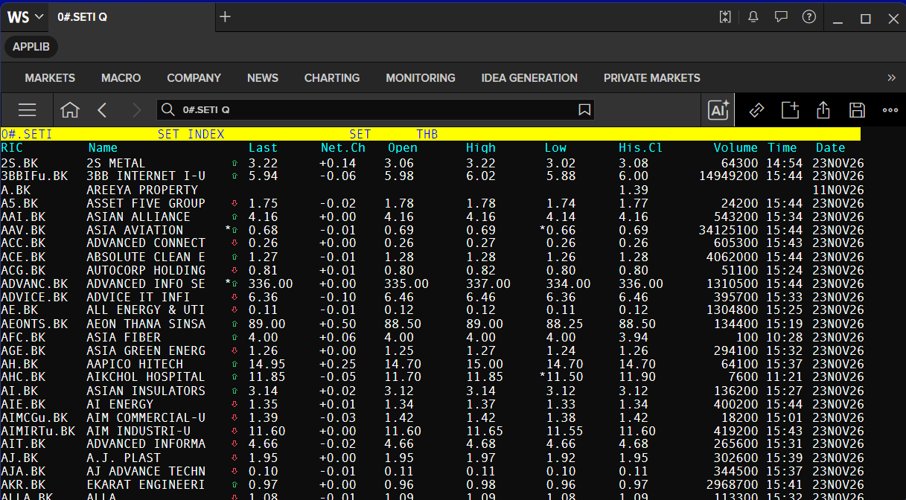

If you change the display view to "display all fields", you see that the *0#.SETI* RIC contains only its constituent names.

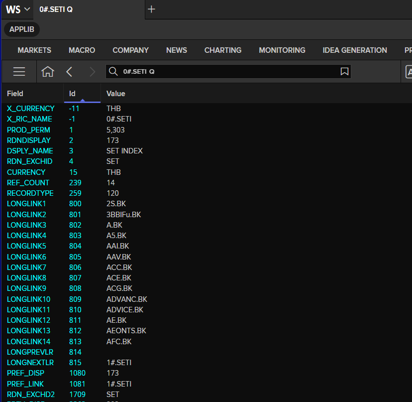 

As market conditions change, chain RICs can change their constituents over time as new RICs are added and existing RICs are removed. Deliverable-basket chains are one example.

## Deliverable Basket Chains Examples 

Here are examples of bond futures deliverable basket chain RICs, built from the active futures contracts found.

| Market | Deliverable Basket Chain | Futures Root | Futures Continuation RIC | Description |
|---|---|---|---|---|
| US Treasury Futures (CBOT) | **0#TYc1=DLV** | *TY* | *TYc1* | CBoT 10-Year US Treasury Note |
| US Treasury Futures (CBOT) | **0#FVc1=DLV** | *FV* | *FVc1* | CBoT 5-Year US Treasury Note |
| US Treasury Futures (CBOT) | **0#TUc1=DLV** | *TU* | *TUc1* | CBoT 2-Year US Treasury Note |
| US Treasury Futures (CBOT) | **0#AULc1=DLV** | *AUL* | *AULc1* | CBoT Ultra T-Bond (Long-term US Treasury) |
| European Government Bond Futures (Eurex) | **0#FGBLc1=DLV** | *FGBL* | *FGBLc1* | Eurex Euro-Bund (10-year German Govt Bond) |
| European Government Bond Futures (Eurex) | **0#FGBMc1=DLV** | *FGBM* | *FGBMc1* | Eurex Euro-Bobl (5-year German Govt Bond) |
| European Government Bond Futures (Eurex) | **0#FGBSc1=DLV** | *FGBS* | *FGBSc1* | Eurex Euro-Schatz (2-year German Govt Bond) |
| UK Gilt Futures (ICE Europe) | **0#FLGc1=DLV** | *FLG* | *FLGc1* | ICE Europe Long Gilt |
| Japan & Australia | **0#JGBc1=DLV** | *JGB* | *JGBc1* | Osaka Exchange 10-Year Japanese Government Bond |
| Japan & Australia | **0#YTTc1=DLV** | *YTT* | *YTTc1* | ASX 3-Year Australian Treasury Bond |
| Japan & Australia | **0#YTCc1=DLV** | *YTC* | *YTCc1* | ASX 10-Year Australian Treasury Bond |

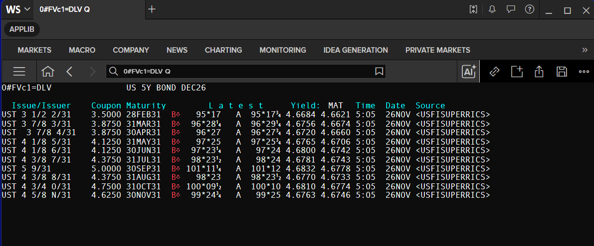

### How the Pattern Works

- **0#** chain RIC prefix, which is an expanding list of constituents.
- **Future Root** (for example, *TY*, *FV*, or *FGBL*) identifies the futures contract series.
- **c1** is the front-month, or nearest, continuation. Substitute *c2* for the second-month contract, *c3* for the third, and so on.
- **=DLV** is the deliverable basket suffix, listing the bonds currently eligible for physical delivery into that futures contract.

The constituent bonds change over time because exchanges periodically update which bonds meet the maturity and coupon criteria for delivery. For instance, newly issued Treasuries are added while older bonds that have fallen below the minimum remaining maturity are removed.

### Note

Please note that not every exchange may expose its deliverable basket through the *=DLV* chain RIC convention. I strongly suggest you contact the Content Support Team to verify the chain ric name and structure of the exchange and data you need.

That covers the chain RICs constituent changed. 

## Prerequisites

1. DataScope Select credentials and permission to access the Tick History REST API
2. Workspace or Data Platform access for the LSEG Data Library for Python
3. Python 3.12 or later
4. Network access to LSEG services

Contact your LSEG Account Manager or CSM team to request API access.

## Code Walkthrough

Now let me move on to step-by-step code walkthrough.

### Set Up Tick History REST API Access  

To use the Tick History REST API, you need DataScope Select (DSS) credentials and permission for the service. Workspace or Data Platform access alone does not grant DSS access; contact your LSEG Account Manager or CSM team to request it.

```python
import os
import time
import requests
import pandas as pd

BASE_URL = "https://selectapi.datascope.lseg.com/RestApi/v1"
TIMEOUT = 30  # seconds

DSS_USERNAME = os.environ.get("DSS_USERNAME")
DSS_PASSWORD = os.environ.get("DSS_PASSWORD")

if not DSS_USERNAME or not DSS_PASSWORD:
    raise ValueError("Please set DSS_USERNAME and DSS_PASSWORD environment variables.")
```

## Authentication with DSS Server

First, request an authentication token from the DSS server. The request must include valid DSS credentials. For details, see [Tick History - REST API Tutorial 1: Connecting to the server](https://developers.lseg.com/en/api-catalog/refinitiv-tick-history/refinitiv-tick-history-rth-rest-api/tutorials#rest-api-tutorial-1-connecting-to-the-server).

This project uses a [Requests Library Session object](https://requests.readthedocs.io/en/latest/user/advanced/#session-objects) for all HTTP requests to DSS. A session reuses the TCP connection when making multiple requests to the same host, which can significantly improve performance. It also lets you set parameters, such as HTTP headers and cookies, that persist across requests.

```python
# Reuse this session and its headers for Tick History requests.
session = requests.Session()
session.headers["Content-Type"] = "application/json"
session.headers["Prefer"] = "respond-async"


#BASE_URL = "https://selectapi.datascope.lseg.com/RestApi/v1"

# Get an access token using the DSS credentials.
try:
    auth_response = session.post(
        f"{BASE_URL}/Authentication/RequestToken",
        json={"Credentials": {"Username": DSS_USERNAME, "Password": DSS_PASSWORD}},
        timeout=TIMEOUT,
    )
    auth_response.raise_for_status()
    print(f"Authentication Tick History response: {auth_response.status_code}")
    token = auth_response.json()["value"]
    if token:
        print("Token obtained")
except requests.exceptions.RequestException as exc:
    raise RuntimeError("DSS authentication request failed") from exc

# Include the token in later API requests.
if token:
    session.headers["Authorization"] = f"Token {token}"
```

Example output:

```text
Authentication Tick History response: 200
Token obtained
```

The DSS authentication token is valid for 24 hours. Include it in the HTTP *Authorization* header as *Token {DSS Token}* in all Tick History data extraction requests.

That’s all I have to say about the 

### Resolving Historical Chain Constituents

That brings us to the Historical Chain expansion part. The Tick History REST API's */Search/HistoricalChainResolution* endpoint resolves the constituents of a Chain RIC for a specified date range. It supports currently active, or inactive 'historical only' instruments.

Notice that the *\_session.post()* statement call does not include an *Authorization* header. We added the header to the *session* object during authentication, so Requests includes it automatically with every request made through that session. 

I define the historical chain constituent extraction in a *resolve_chain_request* function so we can call the endpoint multiple times throughout the workflow. Pass the *session* object to the function as *\_session* each time.

You can find more detail regarding the */Search/HistoricalChainResolution* endpoint from [Tick History - REST API Tutorial 15: Historical Chain Constituents Search](https://developers.lseg.com/en/api-catalog/refinitiv-tick-history/refinitiv-tick-history-rth-rest-api/tutorials#rest-api-tutorial-15-historical-chain-constituents-search).

```python
def resolve_chain_request(request_session, base_url, chain_rics_list, start, end, timeout):
    """Return a dict of `{chain_ric: constituents}` for `chain_rics_list` between `start` and `end`."""
    print(f"Resolving {chain_rics_list} from {start} to {end}")

    payload = {
        "Request": {
            "ChainRics": chain_rics_list,
            "Range": {"Start": start, "End": end},
        }
    }

    try:
        historical_chain_response = request_session.post(
            f"{base_url}/Search/HistoricalChainResolution",
            json=payload,
            timeout=timeout,
        )

        # HTTP 202 = still processing; poll the monitor URL in the Location header until it returns 200
        while historical_chain_response.status_code == 202:
            print("Request is still processing, waiting 5 seconds...")
            time.sleep(5)
            historical_chain_response = request_session.get(historical_chain_response.headers["Location"], timeout=timeout)

        # Stop here if the API reports an error.
        historical_chain_response.raise_for_status()
        print(f"Historical Chain Resolution response: {historical_chain_response.status_code}")
        # Only a completed 200 response contains the constituent data.
        if historical_chain_response.status_code == 200:
            results = historical_chain_response.json().get("value", [])
            if not results:
                print(f"Historical Chain Resolution: No chain resolution results returned for {chain_rics_list}")
                return {}
            # Build a dict that maps each chain RIC to its list of constituents.
            # Example: {"0#TYc1=DLV": [...], "0#FGBMc1=DLV": [...]}
            constituents_by_chain = {chain["Identifier"]: chain.get("Constituents", []) for chain in results}
            for chain_ric, constituents in constituents_by_chain.items():
                print(f"Historical Chain Resolution: {chain_ric} - {len(constituents)} constituents returned")
            return constituents_by_chain
        return {}
    except requests.exceptions.RequestException as exc:
        raise RuntimeError("Historical chain resolution request failed") from exc
```

#### Requesting 2024 Period

Lets make a first */Search/HistoricalChainResolution* endpoint call via *resolve_chain_request* method. I am requesting *0#TYc1=DLV* (CBoT 10-Year US Treasury Note) and *#FGBMc1=DLV* (5-year German Govt Bond) RIC on the May and June 2024 period.

```python
CHAIN_RICS = ["0#TYc1=DLV", "0#FGBMc1=DLV"]
START_2024 = "2024-05-01T00:00:00.000Z"
END_2024 = "2024-06-30T00:00:00.000Z"

# Fetch 2024 constituents via resolve_chain_request()
constituents_2024 = resolve_chain_request(
    request_session=session,
    base_url=BASE_URL,
    chain_rics_list=CHAIN_RICS,
    start=START_2024,
    end=END_2024,
    timeout=TIMEOUT
)
```

Output: 

```text
Resolving ['0#TYc1=DLV', '0#FGBMc1=DLV'] from 2024-05-01T00:00:00.000Z to 2024-06-30T00:00:00.000Z
Historical Chain Resolution response: 200
Historical Chain Resolution: 0#TYc1=DLV - 18 constituents returned
Historical Chain Resolution: 0#FGBMc1=DLV - 6 constituents returned
```

The response is a Python dictionary: each chain RIC is a key, and its value is the list of constituent records for that chain (*{"0#TYc1=DLV": [...], "0#FGBMc1=DLV": [...]}*). For example, *constituents_2024["0#TYc1=DLV"]* returns the constituent records for the CBoT 10-Year US Treasury chain.

The *get_valid_rics* function selects the requested chain's records, keeps only those with *"Status": "Valid"* and *"IdentifierType": "Ric"*, and returns their identifiers. The results are stored in *us_10y_treasury_rics_2024* and *euro_bobl_5y_rics_2024* variables.

```python
def get_valid_rics(constituents,chain_ric):
    """Return identifiers marked valid and typed as RIC for the selected chain."""
    return [
        item["Identifier"]
        for item in constituents[chain_ric]
        if item["Status"] == "Valid" and item["IdentifierType"] == "Ric"
    ]

us_10y_treasury_rics_2024 = get_valid_rics(constituents_2024, CHAIN_RICS[0])
pd.DataFrame(us_10y_treasury_rics_2024, columns=["RIC"])
```

The list of *0#TYc1=DLV* constituents from May to end of June 2024 is as follows (displayed in Pandas format):

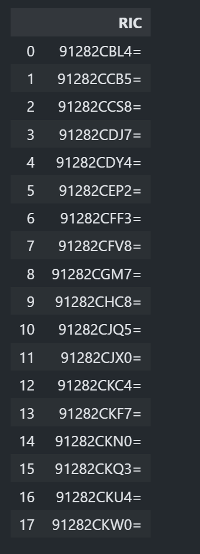

```python
euro_bobl_5y_rics_2024 = get_valid_rics(constituents_2024, CHAIN_RICS[1])
pd.DataFrame(euro_bobl_5y_rics_2024, columns=["RIC"])
```

The list of *0#FGBMc1=DLV* constituents from May to end of June 2024 is as follows:

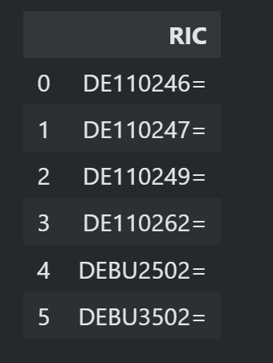

#### Requesting 2026 Period Constituents

Lets try to request the same *0#TYc1=DLV* and *#FGBMc1=DLV* historical constituent RICs on the May and June 2026 period from the Tick History - REST API.

```python
START_2026 = "2026-05-01T00:00:00.000Z"
END_2026   = "2026-06-30T00:00:00.000Z"

# Fetch 2026 constituents via resolve_chain_request()
constituents_2026 = resolve_chain_request(
    request_session = session, 
    base_url = BASE_URL, 
    chain_rics_list = CHAIN_RICS,
    start = START_2026, 
    end = END_2026, 
    timeout = TIMEOUT
)
```

Output:

```text
Resolving ['0#TYc1=DLV', '0#FGBMc1=DLV'] from 2026-05-01T00:00:00.000Z to 2026-06-30T00:00:00.000Z
Historical Chain Resolution response: 200
Historical Chain Resolution: 0#TYc1=DLV - 19 constituents returned
Historical Chain Resolution: 0#FGBMc1=DLV - 5 constituents returned
```

The list of *0#TYc1=DLV* constituents from May to end of June 2026 is as follows:

```python
us_10y_treasury_rics_2026 = get_valid_rics(constituents_2026, CHAIN_RICS[0])
pd.DataFrame(us_10y_treasury_rics_2026, columns=["RIC"])
```

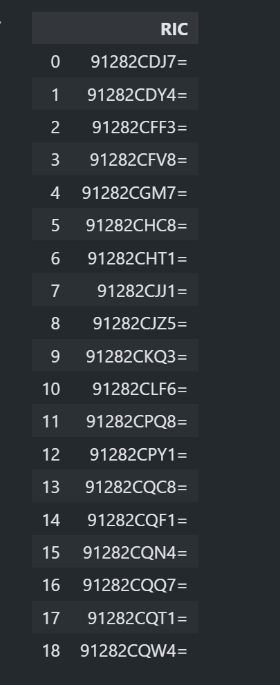

```python
euro_bobl_5y_rics_2026 = get_valid_rics(constituents_2026, CHAIN_RICS[1])
pd.DataFrame(euro_bobl_5y_rics_2024, columns=["RIC"])
```

The list of *0#FGBMc1=DLV* constituents from May to end of June 2026 is as follows:

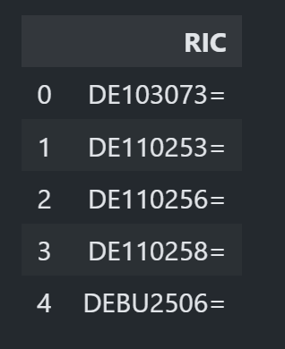

Comparing the 2024 and 2026 constituents for deliverable basket chains show how their constituent bond RICs changed over time.

CBoT 10-Year US Treasury Note

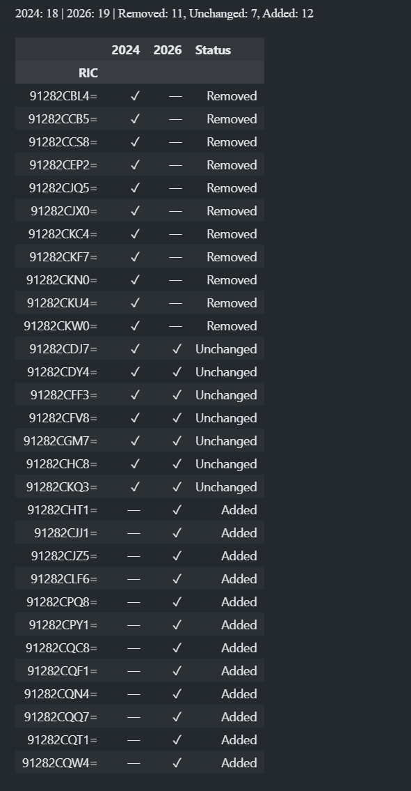

5-year German government bond

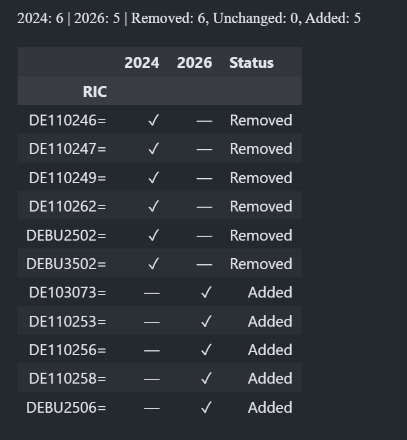

Now we have a set of 2024 and 2026 constituent RICs, we can use the Data Library for Python to get these RICs historical data values.

**Please let me remind you again**: You can use the LSEG Tick History REST API for the entire workflow, including retrieving historical data for these constituents (*us_10y_treasury_rics_2024*, *euro_bobl_5y_rics_2024*, etc.), without using any other LSEG APIs. For example:
- [REST API Tutorial 6: On Demand intraday bars extraction](https://developers.lseg.com/en/api-catalog/refinitiv-tick-history/refinitiv-tick-history-rth-rest-api/tutorials#rest-api-tutorial-6-on-demand-intraday-bars-extraction)
- [REST API Tutorial 4: On Demand tick data extraction](https://developers.lseg.com/en/api-catalog/refinitiv-tick-history/refinitiv-tick-history-rth-rest-api/tutorials#rest-api-tutorial-4-on-demand-tick-data-extraction)

That covers how to get historical chain constituent with the LSEG Tick History - REST API.

### Getting Historical Data with LSEG Data Library for Python

That brings us to the LSEG Data Library. This article workflow below uses a Desktop Session to retrieve historical data for the same RICs and date range from Workspace. You can also use a Platform Session to retrieve data from the Data Platform ([see Data Library for Python QuickStart page](https://developers.lseg.com/en/api-catalog/lseg-data-platform/lseg-data-library-for-python/quick-start)).

The first step is initial the session.

```python
import lseg.data as ld
ld.open_session()
```

Onces the session is opened, we can use the Library's methods and objects to consume data. I am demonstrating with Data Library *get_history* method to request historical data in a simplest way. You can see the example and full potential of this method from [EX-1.01.02-GetHistory.ipynb](https://github.com/LSEG-API-Samples/Example.DataLibrary.Python/blob/lseg-data-examples/Examples/1-Access/EX-1.01.02-GetHistory.ipynb) example code.

Let's see the 2024 historical data of 10-Year US Treasury Note and 5-year German government bonds.

```python
us_10y_treasury_history_2024 = ld.get_history(
    universe=us_10y_treasury_rics_2024[0:6],
    fields=["BID", "ASK"],
    interval="weekly",
    start=START_2024,
    end=END_2024,
)

us_10y_treasury_history_2024.head(20)
```

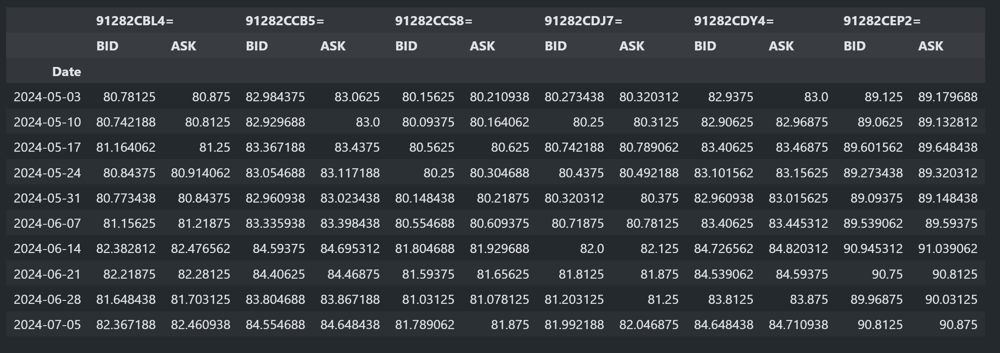

```python
euro_bobl_5y_history_2024 = ld.get_history(
    universe=euro_bobl_5y_rics_2024,
    fields=["BID", "ASK"],
    interval="daily",
    start=START_2024,
    end=END_2024,
)

euro_bobl_5y_history_2024.head(20)
```
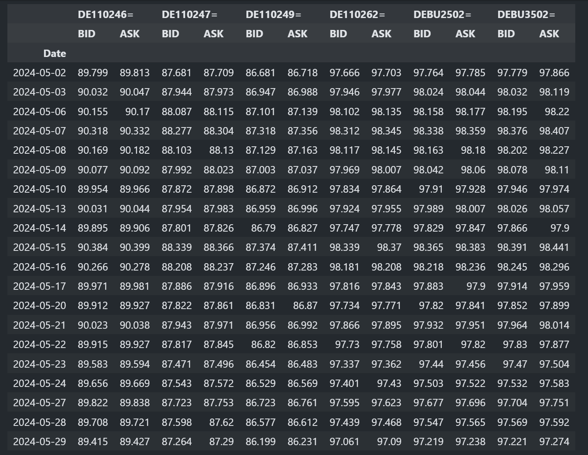

Moving on the May and June 2026 historical data. I am requesting the same query as 2024 for both set of constituents.

```python
us_10y_treasury_history_2026 = ld.get_history(
    universe=us_10y_treasury_rics_2026[0:6],
    fields=["BID", "ASK"],
    interval="weekly",
    start=START_2026,
    end=END_2026,
)

us_10y_treasury_history_2026.head(20)
```

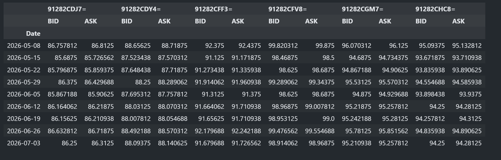

And for the German 5 years government bond in 2026 with daily interval, we have:

```python
euro_bobl_5y_history_2026 = ld.get_history(
    universe=euro_bobl_5y_rics_2026,
    fields=["BID", "ASK"],
    interval="daily",
    start=START_2026,
    end=END_2026,
)

euro_bobl_5y_history_2026.head(20)
```

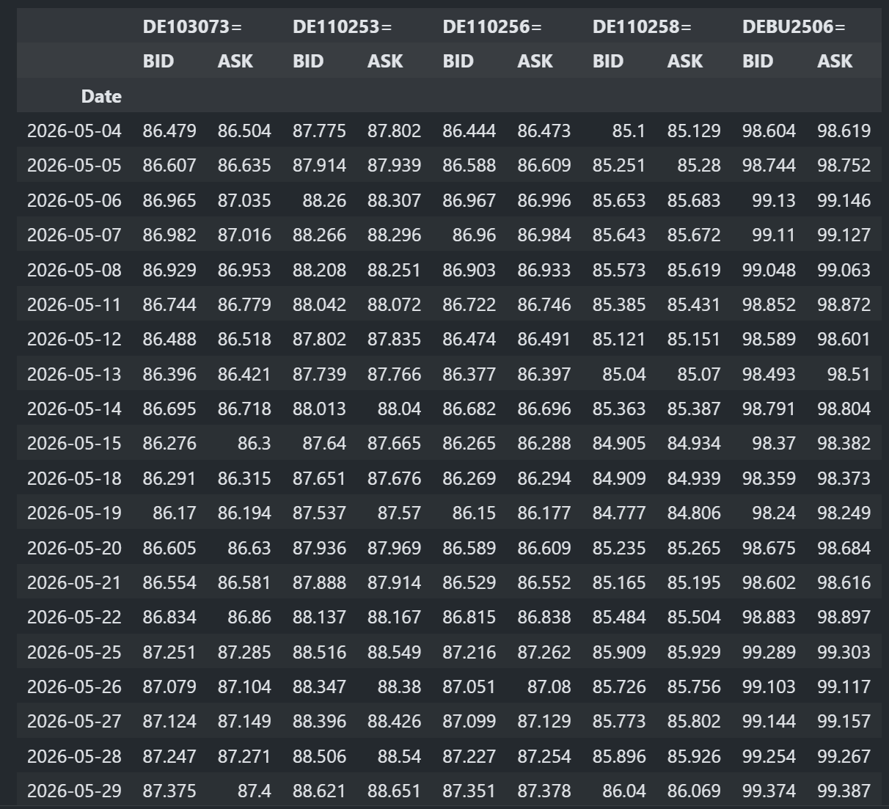

Let’s leave the data retrieval part there.

### Clear The Session

Now, what about how to close the sessions for both API. The Data Library lets you close the with just*ld.close_session()*; method calls. 

```python
ld.close_session()
```

My next point is revoking the Tick History rEST API token.  An application can call */Authentication/InvalidateToken* endpoint to invalidate the token. After a successful request, the token can no longer be used.

```python
try:
    # Ask Tick History to revoke the current token.
    logout_response = session.post(
        f"{BASE_URL}/Authentication/InvalidateToken",
        json={"Token": {"Token": token}},
        timeout=TIMEOUT,
    )
    print(f"Logout Tick History response: {logout_response.status_code}, {logout_response.text}")
    # Raise an error if the token could not be revoked.
    logout_response.raise_for_status()
except requests.exceptions.RequestException as exc:
    raise RuntimeError("DSS InvalidateToken request failed") from exc
```

Output:

```text
Logout Tick History response: 200, {"@odata.context":"https://selectapi.datascope.lseg.com/RestApi/v1/$metadata#Edm.String","value":"Token has been invalidated successfully."}
```

That’s all I have to say about the workflow.

## Summary

Chain constituents can change over time, so the [LSEG Data Library for Python](https://developers.lseg.com/en/api-catalog/lseg-data-platform/lseg-data-library-for-python)'s current **Chain** contents may not represent a historical period. The [LSEG Tick History - REST API](https://developers.lseg.com/en/api-catalog/refinitiv-tick-history/refinitiv-tick-history-rth-rest-api)'s */Search/HistoricalChainResolution* endpoint resolves the constituents of a chain for a requested date range, including inactive, historical-only instruments.

In this article, the resolved May–June 2024 and 2026 constituents for the US Treasury and German Euro-Bobl chains were filtered to valid RICs and compared to identify bonds that were removed, unchanged, or added. Those RICs were then passed to the Data Library's *get_history* method to retrieve BID and ASK prices. This separates historical chain membership lookup from price retrieval, letting you use the LSEG API that best fits each part of your workflow.

That covers all I wanted to say today

## Reference

You can find more detail regarding the LSEG Tick History - REST API and Data Library and Python from the following resources:

- [LSEG Tick History - REST API](https://developers.lseg.com/en/api-catalog/refinitiv-tick-history/refinitiv-tick-history-rth-rest-api) on the [LSEG Developer Community](https://developers.lseg.com/) website
- [LSEG Tick History - REST API Tutorials](https://developers.lseg.com/en/api-catalog/refinitiv-tick-history/refinitiv-tick-history-rth-rest-api/tutorials#rest-api-tutorials-introduction)
- [LSEG Data Library for Python](https://developers.lseg.com/en/api-catalog/lseg-data-platform/lseg-data-library-for-python) 
- [Data Library for Python - Quickstart Guide](https://developers.lseg.com/en/api-catalog/lseg-data-platform/lseg-data-library-for-python/quick-start)
- [Data Library for Python Examples on GitHub](https://github.com/LSEG-API-Samples/Example.DataLibrary.Python) repository

For any question related to this example or LSEG APIs, please use the Developers Community [Q&A Forum](https://community.developers.lseg.com/).